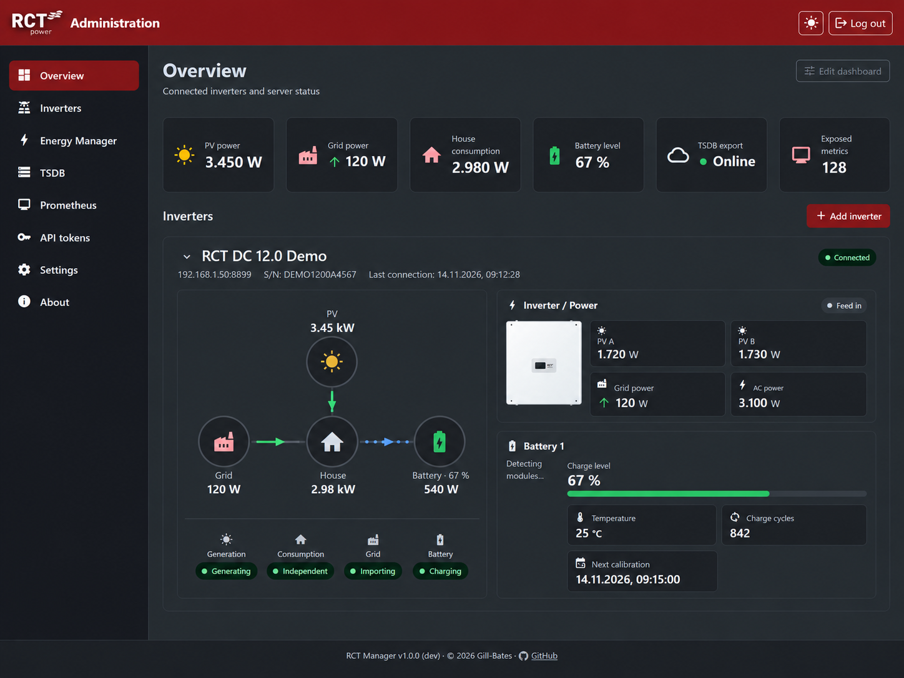
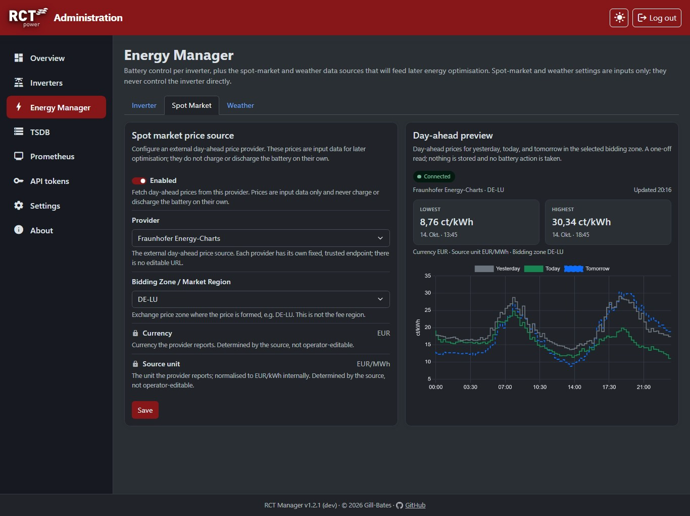

<p align="center">
  
  
</p>

<h2 align="center">Your RCT Power inverter is just one REST call away.</h2>

<p align="center">
  <b>Take charge of your home battery.</b> The Energy Manager lets you charge, hold or
  discharge it with day-ahead spot prices and the solar forecast in view, all from one admin GUI.
</p>

<p align="center">
  <a href="LICENSE"></a>
  
  
  <a href="https://hub.docker.com/r/giiibates/rct-manager"></a>
</p>

<p align="center">
  <a href="https://gill-bates.github.io/rct-manager/"></a>
  <a href="https://gill-bates.github.io/rct-manager/getting-started/quick-start/"></a>
  <a href="https://gill-bates.github.io/rct-manager/energy-manager/"></a>
</p>

---

## What is RCT Manager?

RCT Manager connects to one or more RCT inverters via TCP and exposes their readings and
controls through a REST API, an admin GUI and a live dashboard. No proprietary protocol
handling and no vendor app required.

<p align="center">
  
  <br>
  
</p>

---

## ⚡ Energy Manager

Charge from the grid when power is cheap, keep the battery idle, or discharge it down to a
target state of charge, from the admin GUI or the API. Day-ahead spot prices (Energy-Charts)
and the solar forecast (Open-Meteo) appear on the Energy Manager page and the dashboard.

Safe by default: battery control stays off until you enable write access and verify each
inverter's hardware.

👉 [Learn more about the Energy Manager](https://gill-bates.github.io/rct-manager/energy-manager/)

> [!NOTE]
> **Read-only preview:** the dynamic charging plan turns prices, solar forecast and consumption
> history into a proposed schedule (*Charging plan* tab). It is a dry run: it sends no inverter
> command and never controls the battery.
> [Charging plan](https://gill-bates.github.io/rct-manager/energy/charging-plan/)

---

## ✨ More highlights

- **REST API** for the full protocol catalogue with JSON responses.
  [API overview](https://gill-bates.github.io/rct-manager/api/overview/)
- **Admin GUI and dashboard** for inverters, Energy Manager, export, API tokens and settings.
- **Analytics:** opt-in Prometheus `/metrics` or push export to InfluxDB 2 or QuestDB, with a
  [Grafana dashboard](grafana/dashboard_questdb.json).
  [Push export](https://gill-bates.github.io/rct-manager/configuration/export/)
- **Guarded access:** API tokens, separate admin sessions, writes off by default.
  [Authentication](https://gill-bates.github.io/rct-manager/configuration/authentication/)
- **Multiple inverters** behind one API.
- **Hardened container** for `linux/amd64` and `linux/arm64`: read-only root file system,
  non-root process, health check.

---

## 🚀 Quick start

```sh
cp settings.env.example settings.env   # set HMAC_SECRET, e.g. openssl rand -base64 32
RCT_API_TAG=latest docker compose -f docker/compose.yaml up -d
```

Open `http://127.0.0.1:8000/` and log in with the one-time `admin` password from the startup
log. See the [Quick Start guide](https://gill-bates.github.io/rct-manager/getting-started/quick-start/)
for details and running without Docker.

> [!WARNING]
> Reachable beyond localhost? Terminate TLS in a reverse proxy and enable "behind reverse
> proxy" in the admin GUI.
> [Network and TLS](https://gill-bates.github.io/rct-manager/configuration/network/)

---

## 📚 Documentation

Full documentation: **<https://gill-bates.github.io/rct-manager/>**
[Docker](https://gill-bates.github.io/rct-manager/getting-started/docker/) ·
[Configuration](https://gill-bates.github.io/rct-manager/getting-started/configuration/) ·
[Energy Manager](https://gill-bates.github.io/rct-manager/energy-manager/) ·
[Hardware verification](https://gill-bates.github.io/rct-manager/reference/hardware-verification/) ·
[API](https://gill-bates.github.io/rct-manager/api/overview/) ·
[Operation](https://gill-bates.github.io/rct-manager/operation/) ·
[Troubleshooting](https://gill-bates.github.io/rct-manager/troubleshooting/) ·
[Changelog](CHANGELOG.md)

Like it? Leave a [star](https://github.com/Gill-Bates/rct-manager). Problems or missing
features: open an [issue](https://github.com/Gill-Bates/rct-manager/issues/new/choose).

---

> [!IMPORTANT]
> **Disclaimer:** This is an independent open-source project. It is not affiliated
> with, endorsed by or connected to RCT Power GmbH, Line-Eid-Str. 1, D-78467
> Konstanz. "RCT Power" and related names are trademarks of their respective owners
> and are used only to describe compatibility.

---

## License

Released under the [MIT License](LICENSE). Third-party components retain their
respective licenses.

<p align="center">
  <a href="https://www.buymeacoffee.com/tnsteinerx">
    
  </a>
</p>
