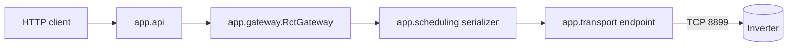
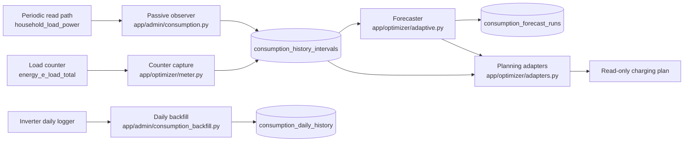

# Architecture

The package is `app`; `run.py` and `python -m app` start it. The wire protocol is
described in the [Protocol Specification](../reference/protocol.md).

## Modules

| Package                     | Role                                                                                                                                                                                                                                                                                                                                                                                                                                                                                                                                                     |
| --------------------------- | -------------------------------------------------------------------------------------------------------------------------------------------------------------------------------------------------------------------------------------------------------------------------------------------------------------------------------------------------------------------------------------------------------------------------------------------------------------------------------------------------------------------------------------------------------- |
| `app/__main__.py`           | CLI: `serve`, `validate`                                                                                                                                                                                                                                                                                                                                                                                                                                                                                                                                 |
| `app/config.py`             | Settings loading and validation                                                                                                                                                                                                                                                                                                                                                                                                                                                                                                                          |
| `app/admin`                 | Admin sessions, password setup, encrypted SQLite persistence, PATs, GUI templates and local assets                                                                                                                                                                                                                                                                                                                                                                                                                                                       |
| `app/api`                   | FastAPI app factory (`app_factory.py`), routers, RFC 9457 problems, middleware, body limit, server                                                                                                                                                                                                                                                                                                                                                                                                                                                       |
| `app/security`              | PAT format and verification, rate limit, client address                                                                                                                                                                                                                                                                                                                                                                                                                                                                                                  |
| `app/gateway`               | `DeviceGateway` port and vendor-neutral DTOs (`base.py`); `RctGateway` (`rct.py`) is the only adapter that turns metric names into frames. The RCT register names behind the Live Charge Envelope and Charge Characterization seams live here (`live_charge_limit.py`, `characterization_readings.py`); the live-limit producer is wired but always returns `None` on this build, and the characterization adapter reads the cache only                                                                                                                  |
| `app/catalog`               | Object registry loaded from `app/catalog/objects.json`                                                                                                                                                                                                                                                                                                                                                                                                                                                                                                   |
| `app/security/allowlist.py` | Validates write targets and values; admin selection is persisted in `data/rct.db`                                                                                                                                                                                                                                                                                                                                                                                                                                                                        |
| `app/protocol`              | Frames, CRC, escaping, stream parser, value codecs, `net.slave_data`                                                                                                                                                                                                                                                                                                                                                                                                                                                                                     |
| `app/transport`             | `TransportEndpoint` owns the TCP connection to one endpoint; demultiplexer, receiver, send gate                                                                                                                                                                                                                                                                                                                                                                                                                                                          |
| `app/scheduling`            | Access serializer (one worker and bounded FIFO queue per endpoint), work budget, retry, single-flight, periodic reads, heartbeat, shutdown                                                                                                                                                                                                                                                                                                                                                                                                               |
| `app/gateway/cache.py`      | Value store with freshness handling                                                                                                                                                                                                                                                                                                                                                                                                                                                                                                                      |
| `app/observability`         | Prometheus exporter, names and statistics                                                                                                                                                                                                                                                                                                                                                                                                                                                                                                                |
| `app/dispatch`              | Battery dispatch: state machine and recovery (`controller.py`), per-device capabilities and gate, SoC-target policy, encrypted crash-durable store, and the Live Charge Envelope seam (`live_limit.py`): a clamp that can only lower charge power, `min(requested, configured static limit, verified-and-fresh live limit)`; the live-limit term defaults to `NullLiveChargeLimitProvider`                                                                                                                                                               |
| `app/energy`                | Energy Manager: business actions in front of battery dispatch, operating mode (off/manual/external), readings port, and the read-only Charge Characterization contract (`characterization.py`): a vendor-neutral capture of independently-aged cached values with per-field freshness and explicit unavailability. `soc_window.py` is the single definition of the effective SoC target window shared with the planner. Characterization is preparation only — no power stepping, no efficiency/AC2BAT computation                                       |
| `app/spotmarket`            | Energy-Charts price provider, bidding-zone metadata and cached price snapshots; read-only input to the admin preview and dashboard                                                                                                                                                                                                                                                                                                                                                                                                                       |
| `app/weather`               | Open-Meteo solar-forecast provider (tilted-plane irradiance → `SolarForecast`), a read-only geocoding client for location search, and a last-known-good forecast cache; read-only input to the admin preview and dashboard, never a control-path dependency                                                                                                                                                                                                                                                                                              |
| `app/optimizer`             | Validated plan and snapshot types, the deterministic consumption forecasters (`consumption.py` median, `adaptive.py` adaptive next-day profile, `meter.py` counter capture), the pure Dry-Run `DynamicChargeOptimizer` (`planner.py`) and the SQLite-backed input adapters with fail-closed horizon and coverage checks (`adapters.py`). It only proposes a plan for the read-only preview; no automatic battery-command execution. The household-load history is collected by `app/admin/consumption.py` into the `consumption_history_intervals` table |
| `app/export`                | Optional push export to InfluxDB 2 / QuestDB, QuestDB provisioning                                                                                                                                                                                                                                                                                                                                                                                                                                                                                       |

## Request path

The API layer authenticates and rate limits a request, resolves device and metric through the
catalog and hands it to the gateway. The gateway submits a transaction to the endpoint's
serializer, which runs one transaction at a time against the inverter. Reads may come from the
cache; `fresh=true` forces a device transaction.

## Adapter port

Another vendor implements `DeviceGateway` from `app/gateway/base.py` and fills the same DTOs;
paths, error keys and status codes stay unchanged.

## Consumption capture and forecast

Capture and forecast are separate components that meet in SQLite. The rules, thresholds and test
evidence of the forecast are in [Consumption Forecast](consumption-forecast.md); user-facing behaviour
is in [Consumption](../energy/consumption.md).

| Concern                                                            | Location                                                                                  |
| ------------------------------------------------------------------ | ----------------------------------------------------------------------------------------- |
| Capture of 15-minute buckets, counter differencing, daily backfill | `app/admin/consumption.py`, `app/optimizer/meter.py`, `app/admin/consumption_backfill.py` |
| Forecast (median fallback, adaptive next day)                      | `app/optimizer/consumption.py`, `app/optimizer/adaptive.py`                               |
| Daily forecast storage and evaluation                              | `ConsumptionHistorian` (`app/admin/consumption.py`)                                       |
| Plan inputs                                                        | `app/optimizer/adapters.py`                                                               |

The forecaster is stateless: its state is replayed from the stored history on every call.

### Response-only logger types

The logger objects use a compound **response-only** protocol type: the request carries a `t_int32`
timestamp, but the reply is decoded as a different type than the request. `TIMESERIES` is the reply of
the day-energy loggers (`logger_day_eload_log_ts`), and `EVENT_TABLE` is the reply of
`logger_error_log_time_stamp`. Such objects are classified read-only, never writable and never
actions, and are kept off the scalar metric surface and out of the write allowlist. The `EVENT_TABLE`
wire format is **not** decoded. Verification status of these objects:
[Hardware Verification](../reference/hardware-verification.md).
