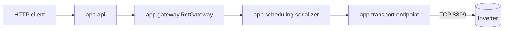

# Architecture

The package is `app`; `run.py` and `python -m app` start it. The wire protocol is
described in the [Protocol Specification](../reference/protocol.md).

## Modules

| Package | Role |
| --- | --- |
| `app/__main__.py` | CLI: `serve`, `validate` |
| `app/config.py` | Settings loading and validation |
| `app/admin` | Admin sessions, password setup, encrypted SQLite persistence, PATs, GUI templates and local assets |
| `app/api` | FastAPI app factory (`app_factory.py`), routers, RFC 9457 problems, middleware, body limit, server |
| `app/security` | PAT format and verification, rate limit, client address |
| `app/gateway` | `DeviceGateway` port and vendor-neutral DTOs (`base.py`); `RctGateway` (`rct.py`) is the only adapter that turns metric names into frames. The RCT-specific register names behind the Live Charge Envelope and Charge Characterization seams live here (`live_charge_limit.py`, `characterization_readings.py`); the live-limit producer is wired but unconditionally returns `None` on this build until a per-device hardware-verification contract exists, and the characterization adapter reads the cache only |
| `app/catalog` | Object registry loaded from `app/catalog/objects.json` |
| `app/security/allowlist.py` | Validates write targets and values; admin selection is persisted in `data/rct.db` |
| `app/protocol` | Frames, CRC, escaping, stream parser, value codecs, `net.slave_data` |
| `app/transport` | `TransportEndpoint` owns the TCP connection to one endpoint; demultiplexer, receiver, send gate |
| `app/scheduling` | Access serializer (one worker and bounded FIFO queue per endpoint), work budget, retry, single-flight, periodic reads, heartbeat, shutdown |
| `app/gateway/cache.py` | Value store with freshness handling |
| `app/observability` | Prometheus exporter, names and statistics |
| `app/dispatch` | Battery dispatch: state machine and recovery (`controller.py`), per-device capabilities and gate, SoC-target policy, encrypted crash-durable store, and the Live Charge Envelope seam (`live_limit.py`): a safety clamp that can only lower charge power, `min(requested, configured static limit, verified-and-fresh live limit)`. The live-limit term defaults to `NullLiveChargeLimitProvider` and never raises the static bound |
| `app/energy` | Energy Manager: business actions in front of battery dispatch, operating mode (off/manual/external), readings port, and the read-only Charge Characterization contract (`characterization.py`): a vendor-neutral capture of independently-aged cached values with per-field freshness and explicit unavailability. `soc_window.py` is the single definition of the effective SoC target window shared with the planner. Characterization is preparation only — no power stepping, no efficiency/AC2BAT computation |
| `app/spotmarket` | Energy-Charts price provider, bidding-zone metadata and cached price snapshots; read-only input to the admin preview and dashboard |
| `app/weather` | Open-Meteo solar-forecast provider (tilted-plane irradiance → `SolarForecast`), a read-only geocoding client for location search, and a last-known-good forecast cache; read-only input to the admin preview and dashboard, never a control-path dependency |
| `app/optimizer` | Validated plan and snapshot types, the deterministic consumption forecasters (`consumption.py` median, `adaptive.py` adaptive next-day profile, `meter.py` counter capture), the pure Dry-Run `DynamicChargeOptimizer` (`planner.py`) and the SQLite-backed input adapters with fail-closed horizon and coverage checks (`adapters.py`). It only proposes a plan for the read-only preview; no automatic battery-command execution. The household-load history is collected by `app/admin/consumption.py` into the `consumption_history_intervals` table |
| `app/export` | Optional push export to InfluxDB 2 / QuestDB, QuestDB provisioning |

## Request path

A request is authenticated and rate limited in the API layer, resolved to a
device and metric through the catalog, and handed to the gateway. The gateway
submits a transaction to the endpoint's serializer, which executes one
transaction at a time against the inverter. Reads may be served from the cache;
`fresh=true` forces a device transaction.

## Adapter port

Another device vendor implements the `DeviceGateway` protocol from
`app/gateway/base.py` and fills the same DTOs, without changing paths, error
keys or status codes.

## Consumption capture and adaptive next-day forecast

### Capture (`meter.py`, `consumption.py`)

The cumulative load counter `energy_e_load_total` (Wh, float32) is differenced into 15-minute buckets
next to the integrated `household_load_power`. A gap of at most 300 s is measured; a longer one up to
24 h is spread as a flagged estimate. Resets, deltas above 50 kW, stalled counters and gaps over 24 h are
rejected and counted; the day counter is the fallback. A `HistoryBucket` is COMPLETE (at least 810 s
measured), PARTIAL (at least 600 s), ESTIMATED or MISSING.

Unverified without hardware evidence: the unit and day semantics of the day history (`logger_day_eload_log_ts`, TIMESERIES reply; the wire layout follows the rctclient protocol notes; the backfill is off by default), the reset
instant and time zone of the day counter, total-counter reset or overflow behaviour, and whether the
counter includes external power. Nothing beyond "non-decreasing between resets" is assumed.

The logger objects use a compound **response-only** protocol type: the request carries a `t_int32`
timestamp, but the reply is decoded as a different type than the request. `TIMESERIES` is the reply of
the day-energy loggers (`logger_day_eload_log_ts`), and `EVENT_TABLE` is the reply of
`logger_error_log_time_stamp`. Such objects are classified read-only — never writable, never actions —
and are kept off the scalar metric surface and out of the write allowlist. `EVENT_TABLE` is classified
read-only only; its wire format is **not** decoded, and neither its unit nor its day-timestamp semantics
are verified on hardware.

### Adaptive forecast (`adaptive.py`)

`AdaptiveConsumptionForecaster` keeps the interface of the median forecaster (`build`,
`horizon_coverage_ratio`, `coverage_end`) and adds `analyze` and `next_day_forecast`. It separates the
**everyday profile** from the **consumption phase** (`normal`, `suspected_low_activity`; the data cannot
tell a holiday from other reasons, so it is never called absence). Nothing is stored: the state is
**replayed** from the stored history, bucket by bucket and without look-ahead, on every call, so a
restart reconstructs it exactly. Fewer than 14 learned days gives `insufficient_history`, reported in
`reasons`, and the median forecast answers.

| Rule | Value | Reason |
| --- | --- | --- |
| Observation | COMPLETE, or PARTIAL with at least 750 s | extrapolation stays below 1.2; ESTIMATED and MISSING never teach or trigger anything, an outage leaves windows thinner, never zero |
| Profile | capped mean (cap 1.5 x median) of the newest 8 samples per weekday and quarter hour, else 21 per time of day, at least 3 | a plain median under-forecasts energy, an uncapped mean follows single consumers |
| Learning lag | a bucket is learned 24 h after it ended, only in the normal state | equals the entry window: nothing of a phase onset has been learned when it is detected; the profile stays frozen during a phase and for the detection edge after a return |
| Enter | 24 h window, at least 68 observed buckets, capped energy ratio (bucket cap 2 x expected) below 0.60 | everyday windows sit near 1.0, a 14-day standby phase near 0.15; the cap limits a lone consumer |
| Return | the newest 16 informative buckets (expected at least 2 x the low level and 15 Wh more), at least 75 % closer to the profile than to the low level, at least 4 reproducing a profile peak (4 x low level, 70 % of the way), twice in a row, evidence not older than 8 h; buckets above 3 x expected are no evidence | a single spike, a heavy appliance or a few moderate hours cannot satisfy this; nights carry no evidence |
| Hysteresis | entering needs 68 fresh buckets after a return (the window is reset) and a ratio of 0.60, returning needs the evidence above | no flip-flop; the two paths use different measures |
| Level factor | median of the last 5 daily ratios (at least 3), applied beyond a 10 % dead band, clamped 0.2 to 5; profile samples are stored divided by the level | learns permanent change in about 3 days and shows it as a `level_changed` event |
| Promotion | a phase of 28 days becomes the new normal: the profile is rebuilt from it | a permanent drop is not held at "suspected" forever |
| Low-phase forecast | per quarter-hour median of the last 7 days of the phase (at least 3), else the standby level (median, first estimate from the newest 12 h of the entry window) | standby is flat, a scaled everyday profile has the wrong shape |

`analyze` returns profile basis and days, level factor, phase, detection and return instants, data
coverage of the last 7 days, the daily spread, return evidence, reasons and the last events. The
next local day (92, 96 or 100 slots) is stored by `ConsumptionHistorian` once per target day after 22:00
local time, for the adaptive and the median method (`consumption_forecast_runs/values`, explanation as
JSON). Later runs are compared with COMPLETE actuals (at least 90 % of the slots): daily energy error and
quarter-hour MAE, logged at INFO. The admin API does not yet expose `analysis`.

### Scenario evidence

`tests/test_consumption_adaptive.py` replays synthetic households (`tests/consumption_scenarios.py`,
about 9 kWh a day, noise and random loads, Europe/Berlin); a forecast sees only buckets ended before it
was made. Mean absolute daily-energy error, adaptive / median, six seeds, issued 22:00:

| Situation | Adaptive | Median |
| --- | --- | --- |
| Everyday, days 20 to 55 | 13.8 % (MAE 18.3 Wh) | 14.6 % (18.2 Wh) |
| 14-day low phase, days 2 to 14 | 6.7 % | 371 % |
| Same, return at 18:00: return day, +1, +2, +3 | 17.9, 12.6, 13.0, 13.1 % | 23.1, 17.8, 18.1, 18.5 % |
| No return, days 2 to 28 | 1.5 % | 372 % |
| Level +40 %, days 1-2 / 3-5 / 6-8 | 35 / 21 / 10 % | 36 / 36 / 35 % |
| Level -25 %, days 9-20 | 17 % (MAE 17 Wh) | 10.5 % (MAE 24 Wh) |

The median method stays near the everyday level during a low phase because the same weekday of the
older weeks still dominates, hence its large error there. Both methods under-forecast everyday energy by about 13 %
(random loads); the -25 % row is worse in daily energy because the generator's random loads do not
scale with the level.

Detection delays (8 seeds): a low phase is recognised 18.0 to 18.8 h after its onset at midnight. A return
is recognised 3.2 to 3.8 h after an 18:00 or 15:00 arrival, 4 to 5.5 h after 06:00, 7 h after midday,
10 h after 09:00 or 00:00 (peaks are required), 14 h after 21:00 (the night gives no evidence). Before
that signal the forecast stays low; this cannot be avoided. False switches: 0 low detections in 12 seeds
of 100 everyday days; 0 false returns with one-bucket spikes, 90-minute heavy appliances or 250 W for
three hours on half of the days; 4 of 8 seeds falsely returned with 350 W for three hours (a person at
home in practice). A false return costs about one day until a new phase is detected.

Limits: a phase detected inside the first 14 days of history is learned as everyday; a history that
starts inside a phase teaches it as everyday; after a promotion the return is a level change (about
3 days); the retained 60 days bound the replay, so older profile samples disappear.

