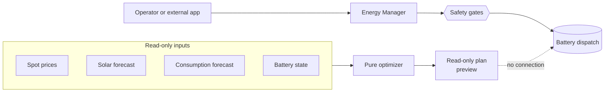
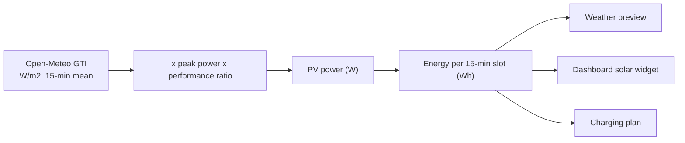

# Energy Manager

The Energy Manager turns one business decision ("charge to 80 % now") into a battery dispatch command.
The admin GUI page **Energy Manager** and the REST API share one control path. Around it sit read-only
inputs (spot prices, solar forecast, consumption history) and a **read-only charging plan preview**
that proposes when to charge from the grid.

-   :material-chart-timeline-variant:{ .lg .middle } **Charging Plan**

    ---

    Read-only preview of when to charge from the grid, from prices, solar and consumption forecast.

    [:octicons-arrow-right-24: Charging Plan](energy/charging-plan.md)

-   :material-home-lightning-bolt:{ .lg .middle } **Consumption**

    ---

    15-minute measurement history, daily backfill from the inverter's logger, forecast learning.

    [:octicons-arrow-right-24: Consumption](energy/consumption.md)

-   :material-battery-lock:{ .lg .middle } **Battery Control**

    ---

    Off / Manual / External, write access, hardware verification gates, charge limits.

    [:octicons-arrow-right-24: Battery Control](energy/battery-control.md)

-   :material-clipboard-check-outline:{ .lg .middle } **Hardware Verification**

    ---

    What is verified on real hardware and what is not.

    [:octicons-arrow-right-24: Hardware Verification](reference/hardware-verification.md)

## What writes to the inverter, and what does not

| Component                                                      | Writes to the inverter? | Purpose                                                        |
| -------------------------------------------------------------- | ----------------------- | -------------------------------------------------------------- |
| Spot Market                                                    | No                      | Day-ahead prices for the dashboard and the plan                |
| Weather                                                        | No                      | Solar production forecast for the dashboard and the plan       |
| Consumption history and backfill                               | No (read-only queries)  | Household consumption record and forecast                      |
| **Charging plan**                                              | **No**                  | Read-only charging plan preview (Dry-Run); proposes a schedule |
| Energy Manager actions (`charge`, `discharge`, `hold`, `auto`) | Yes, behind four gates  | Battery dispatch                                               |

## Charging plan in short

The planner reads local data only (persisted spot prices, solar forecast, the consumption forecast and
the current battery state), simulates the battery without grid charging, and places the grid energy
needed to protect the reserve into the **latest permitted slots**. It sends no inverter command: no
automatic executor, no `Dynamic` operating mode, no register write.

| Input                | Source                                                                     |
| -------------------- | -------------------------------------------------------------------------- |
| Spot prices          | Energy-Charts, stored in SQLite                                            |
| Solar forecast       | Open-Meteo, stored in SQLite                                               |
| Consumption forecast | Local 15-minute history, adaptive or median                                |
| Battery state        | SoC from the read cache, verified usable capacity, configured power limits |

Details, status codes and the preview API: [Charging Plan](energy/charging-plan.md).

!!! note "Usable battery capacity"
    The plan needs a verified current usable capacity or an Expert override. Module count gives a
    rated 100 % reference, while live Ah readings have not proven current capacity. Without an
    override it reports `battery_state_unavailable`. See
    [Usable battery capacity](energy/charging-plan.md#usable-battery-capacity).

## Consumption in short

The service keeps its own 15-minute `household_load_power` history (no additional inverter reads,
rolling 60 days). The inverter's daily load logger fills missed days with daily totals only; it never
becomes quarter-hour data and never trains the forecast. Details:
[Consumption](energy/consumption.md).

## Safety model

| Gate                         | Switch                                                                           |
| ---------------------------- | -------------------------------------------------------------------------------- |
| 1. **Write access**          | Inverters page, global; choosing a mode never turns it on                        |
| 2. **Operating mode**        | Off / Manual / External, per inverter                                            |
| 3. **Hardware verification** | Per-device capabilities verified automatically in the background; an Expert override remains available |
| 4. **Dispatch**              | Charge power clamped to the configured limit, commands expire after one hour     |

!!! warning "Battery control is off until you enable and verify it"
    A newly added inverter has no confirmed mode. Commands answer 409 `energy_manager_off` until an
    operator selects Manual or External in the GUI. The charging plan bypasses none of these gates
    because it never dispatches. Flow and details: [Battery Control](energy/battery-control.md#safety-gates).

### Modes in short

| Mode     | Who may command                                                                   | Use                                |
| -------- | --------------------------------------------------------------------------------- | ---------------------------------- |
| Off      | Nobody; the inverter runs its Internal SoC strategy                               | Default and hand-back              |
| Manual   | The admin GUI (charge, keep idle, discharge)                                      | Operator control                   |
| External | The REST API with a read/write token (`POST /api/v1/devices/{id}/energy/command`) | Home automation or an external app |

Actions, error codes, restore behaviour and the GUI layers: [Battery Control](energy/battery-control.md).

## Spot Market

In **Energy Manager > Spot Market**, choose a bidding zone and save it to the admin database. The
source is disabled by default; currency and unit are read-only; network fees are not added.

The preview shows the zone's prices for yesterday, today and tomorrow. The source reports EUR/MWh;
prices are normalized to EUR/kWh internally and shown as cents per kWh. Tomorrow's curve is published
around 12:45 CET (SDAC auction), so it is normally absent in the morning. A complete day has 96
quarter-hour intervals (92 or 100 on daylight-saving days).

- Intervals live in the SQLite `spot_market_intervals` table, the zone list in the admin database. The
  UI reads only from SQLite; page views, previews and restarts never call the provider.
- One daily retrieval fetches tomorrow's prices (and the zone list) from 13:00 Europe/Berlin, only while
  tomorrow is missing; nothing is requested until the next day. Only an empty database (first start)
  also fetches today and yesterday.
- A failed retrieval is retried with a growing delay (5 minutes up to 1 hour) and logged as a warning.
  While due data is missing, the preview and dashboard show a stale warning; an unpublished tomorrow
  counts as a failure only one hour after 13:00.
- The table keeps only the current three local days, no history. If tomorrow is not published, its rows
  stay absent and the preview shows the availability hint. Inverter control is never affected.

!!! note "Raw market price"
    The displayed price is the day-ahead market (exchange) price only. It is **not** a complete
    household electricity price: it excludes network fees, taxes, levies and supplier margin.

Admin routes `/admin/api/energy/spot-market/config` (`GET`, `PUT`),
`/admin/api/energy/spot-market/bidding-zones` (`GET`) and `/admin/api/energy/spot-market/preview`
(`POST`) require an admin session (writes also CSRF); they are not public token routes.

## Weather and solar forecast

In **Energy Manager > Weather**, configure a solar production forecast from
[Open-Meteo](https://open-meteo.com/). Like the spot market it is a read-only input and never charges
or discharges the battery. It is disabled by default; a disabled or incomplete configuration makes no
network request.

Type a city or postal code into the location search; the server resolves it through its geocoder
(`GEOCODING_PROVIDER` operator setting: `photon` default, `open_meteo` legacy) and offers a short pick
list. The forecast itself always runs on Open-Meteo. Choosing an entry fills in the coordinates, and the
time zone when the geocoder reports one. Photon reports none, so local-time display then falls back to
UTC; the forecast is always computed in UTC. The browser never calls the geocoder directly; every
request goes through the admin API to the providers' fixed endpoints.

Describe your PV array so the forecast can turn irradiance into expected power:

| Field                 | Meaning                                                                                                                            |
| --------------------- | ---------------------------------------------------------------------------------------------------------------------------------- |
| **Location**          | Latitude and longitude; a descriptive name is optional.                                                                            |
| **Peak power**        | PV nameplate DC power, entered in kilowatt-peak (kWp), for example 10.0; stored internally in watt-peak (Wp).                      |
| **Tilt**              | Module angle from horizontal: 0 degrees flat, 90 degrees vertical.                                                                 |
| **Azimuth**           | Open-Meteo convention: 0 = south, -90 = east, +90 = west, +-180 = north.                                                           |
| **Performance ratio** | A single factor in (0, 1] (default 0.85) folding inverter, wiring, soiling and temperature losses into one transparent multiplier. |

A disabled configuration may be saved incomplete; enabling it requires every forecast value. The model
is deliberately simple and never patches a provider value: a missing, negative or mistyped reading is
reported as an error.

The preview shows the production curve and energy for the next 24 hours. Quarter-hour intervals (96 per
local day, 92 or 100 on daylight-saving days) are stored in the SQLite `solar_forecast_intervals`
table; no history is kept.

- A background refresh replaces the contents with the latest three local days once per local day (when
  today or tomorrow is missing, so the next-24-hours figure is always backed by stored data).
- A failed retrieval is retried with a growing delay and warned about in the log and, while data is
  missing, in the preview and dashboard.
- Preview and dashboard read only from the table, never from the provider. Changing the saved
  configuration clears the previous rows before the refresh starts.

Admin routes `/admin/api/energy/weather/config` (`GET`, `PUT`), `/admin/api/energy/weather/locations`
(`GET`, geocoding search) and `/admin/api/energy/weather/preview` (`POST`) require an admin session
(writes also CSRF); they are not public token routes.

!!! note "Attribution"
    The free Open-Meteo Open-Access endpoint needs no API key and is for non-commercial use under
    CC BY 4.0 ("Weather data by Open-Meteo.com"), with no availability guarantee. Location search
    attribution follows the active geocoder: Photon, "Location data from Photon (c) OpenStreetMap
    contributors" (ODbL); Open-Meteo geocoder, "Location data based on GeoNames via Open-Meteo". The
    Weather tab itself no longer displays these credits. The endpoints must not be polled aggressively
    (roughly 10,000 requests per day), so the forecast retrieval (once per local day) is fixed in code
    and the location search uses a short-lived server-side cache.

## Where to go next

| Topic                                                | Page                                                        |
| ---------------------------------------------------- | ----------------------------------------------------------- |
| Plan inputs, policy, replanning, preview API         | [Charging Plan](energy/charging-plan.md)                    |
| Measurement history, backfill, daily consumption API | [Consumption](energy/consumption.md)                        |
| Modes, actions, gates, restore, GUI                  | [Battery Control](energy/battery-control.md)                |
| REST routes                                          | [API endpoints](api/endpoints.md#energy-manager)            |
| Verified versus unverified hardware behaviour        | [Hardware Verification](reference/hardware-verification.md) |
| Forecast algorithm                                   | [Consumption Forecast](development/consumption-forecast.md) |
