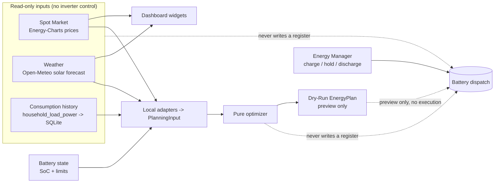
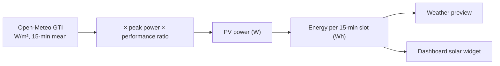

# Energy Manager

The Energy Manager turns one business decision ("charge to 80 % now") into a battery dispatch
command. The admin GUI page **Energy Manager** and the REST API share one control path, so both
behave identically.


The **Spot Market** tab configures the Energy-Charts price source and shows a
read-only day-ahead preview. The **Weather** tab configures an Open-Meteo solar
production forecast and shows a read-only preview. Neither tab schedules or
executes a battery command: both are read-only inputs for the dashboard and for
the dynamic charging planner.

The dynamic charging planner now exists as a **Dry-Run**: it reads local
measurements, spot prices, the solar forecast and the battery state and produces
a traceable charging plan for preview only. It never commands the battery — there
is no automatic execution, no `Dynamic` operating mode, and no register write
anywhere in the planner. See [Dynamic charging plan (Dry-Run)](#dynamic-charging-plan-dry-run).



## Spot Market

In **Energy Manager → Spot Market**, choose a bidding zone. The source currency
and unit are read-only. Network fees are not calculated or added. Save the
configuration to retain it in the admin database. The source is disabled by
default.

The preview shows the saved bidding zone's prices for yesterday, today and
tomorrow. The source reports EUR/MWh;
prices are normalized to EUR/kWh internally and shown as cents per kWh.
Tomorrow's curve is published
around 12:45 CET (SDAC day-ahead auction), so it is normally absent in the morning.
Price intervals are stored in the SQLite `spot_market_intervals` table and the
bidding-zone list in the admin database. Everything the UI shows is read from SQLite;
page views, previews and restarts never call the provider. One daily retrieval fetches
tomorrow's prices (and the zone list) from 13:00 Europe/Berlin (market time), only
while tomorrow is missing from the database; afterwards nothing is requested until the
next day. Only an empty database (first start) also fetches today and yesterday. A failed
retrieval is retried with a growing delay (5 minutes up to 1 hour), logged as a warning
and, while data that is due is still missing, shown as a stale warning in the preview and
dashboard; an unpublished tomorrow only counts as a failure one hour after 13:00. The
table keeps only the current three local days; no price history is kept. It never changes
inverter control.
Each complete day contains 96 quarter-hour intervals; local daylight-saving
transitions naturally contain 92 or 100 intervals. If tomorrow is not published,
its table rows remain absent and the preview shows the availability hint.

The displayed price is the day-ahead market (exchange) price only. It is **not**
a complete household electricity price: it excludes your network fees, taxes,
levies and supplier margin. Treat it as the raw market price, not what you pay
per kWh.

The admin routes `/admin/api/energy/spot-market/config` (`GET`, `PUT`),
`/admin/api/energy/spot-market/bidding-zones` (`GET`) and
`/admin/api/energy/spot-market/preview` (`POST`) require an admin session; writes
also require CSRF. They are not public token API routes.

## Weather

In **Energy Manager → Weather**, configure a solar production forecast from
[Open-Meteo](https://open-meteo.com/). The forecast is a read-only input: like
the spot-market source, it never charges or discharges the battery. The source
is disabled by default, and a disabled or incomplete configuration makes no
network request at all.

Type a city or postal code into the location search; the server resolves it
through its location geocoder and offers a short pick list. The default geocoder
is Photon over OpenStreetMap data, selectable with the `GEOCODING_PROVIDER`
operator setting (`photon` default, `open_meteo` as a legacy alternative). The
solar forecast itself always runs on Open-Meteo regardless of this setting.
Choosing an entry fills in the coordinates (and the time zone when the geocoder
reports one). Photon carries no IANA time zone, so when it is the active geocoder
the time zone is not auto-filled and local-time display falls back to UTC; the
forecast is always computed in UTC. The browser never calls the geocoder
directly — every request goes through the admin API against the provider's fixed
endpoints.

Describe your PV array so the forecast can turn irradiance into expected power:

| Field | Meaning |
| --- | --- |
| **Location** | Latitude and longitude; a descriptive name is optional. |
| **Peak power** | PV nameplate DC power, entered in kilowatt-peak (kWp), e.g. 10.0; stored internally in watt-peak (Wp). |
| **Tilt** | Module angle from horizontal: 0° flat, 90° vertical. |
| **Azimuth** | Orientation in the Open-Meteo convention: 0° = south, -90° = east, +90° = west, ±180° = north. |
| **Performance ratio** | A single factor in (0, 1] (default 0.85) folding inverter, wiring, soiling and temperature losses into one transparent multiplier. |

A disabled configuration may be saved while still incomplete; enabling it
requires every forecast value. The forecast uses a deliberately simple, fully
documented model and never patches a provider value — a missing, negative or
mistyped reading is reported as an error rather than silently repaired:



The preview shows the saved configuration's production curve and energy for the
next 24 hours. Solar forecast intervals are stored in a separate SQLite
`solar_forecast_intervals` table. A background refresh replaces its contents
with the latest three local days once per local day (when today or tomorrow is missing from
the table, so the next-24-hours figure is always backed by stored data); a failed retrieval is
retried with a growing delay and warned about in the log and, while data is missing, in the
preview and dashboard. The Weather preview and
dashboard read only from this table; they do not make provider calls. Changing
the saved forecast configuration clears the previous rows before refresh starts.
No forecast history is retained.
The source supplies quarter-hour intervals, normally 96 per local day (92 or 100
on daylight-saving transition days).

The admin routes `/admin/api/energy/weather/config` (`GET`, `PUT`),
`/admin/api/energy/weather/locations` (`GET`, geocoding search) and
`/admin/api/energy/weather/preview` (`POST`) require an admin session; writes
also require CSRF. They are not public token API routes.

!!! note "Attribution"
    The free Open-Meteo Open-Access endpoint needs no API key and is intended
    for non-commercial use under CC BY 4.0: "Weather data by Open-Meteo.com".
    Free non-commercial use with no availability guarantee. The location search's
    attribution follows the active geocoder: with the default Photon geocoder it
    is "Location data from Photon © OpenStreetMap contributors" (OpenStreetMap
    data under the ODbL, credit the OpenStreetMap contributors); with the
    Open-Meteo geocoder it is "Location data based on GeoNames via Open-Meteo".
    All credits are recorded here in the documentation; the Weather tab itself no
    longer displays them. The endpoints must not be polled aggressively (roughly 10,000 requests per day),
    which is why the forecast retrieval (once per local day) is fixed in code and the location
    search is served through a short-lived server-side cache.

## Dynamic charging plan (Dry-Run)

The dynamic charging planner turns the local data sources into a proposed charging
plan. This first version is a **Dry-Run**: it only produces a plan for preview and
evaluation and never controls the battery. There is no automatic executor, no
`Dynamic` operating mode, and the planner issues no `EnergyManager.command()`,
dispatch command or register write. The Energy Manager (Off / Manual / External)
stays the only path that can command the inverter.

### Local consumption history

The planner needs the house's own consumption, so the service builds a local
history of the `household_load_power` metric. It reuses the value that is already
received over the periodic read path — it causes **no additional inverter reads**
and does not depend on QuestDB, InfluxDB or metrics export being enabled. A small
passive observer buffers each received value; a background task integrates the
buffered power samples into fixed 15-minute energy buckets off the receiver path
and writes them to the `consumption_history_intervals` SQLite table (one row per
device and quarter hour). A SQLite error there can never disturb the inverter
connection or the read cache.

Energy is integrated **time-weighted** (`Wh = W × hours`) between consecutive
samples and split correctly across any 15-minute boundary a sample interval
crosses. A negative, non-finite or missing reading is kept as a measurement-gap marker: it adds no energy
and no sample count, and the integration never bridges across it. Each
bucket stores how well it is backed — `sample_count` and `coverage_seconds` (at
most 900 s) — so a poorly-covered bucket can later be treated as uncertain.
Missing samples are never read as `0 W`, and a dropout longer than the documented
maximum integration gap (5 minutes) leaves the period uncovered instead of
fabricating energy across it. History is kept for a rolling **60 days** (a code
default); pruning touches only the consumption table, never the price or
solar-forecast rows.

### Inverter day history (daily reconciliation)

The inverter's daily load logger is used as a read-only reconciliation source for completed local calendar days. It can bootstrap daily consumption history and repair multi-day application outages. Daily inverter values are never expanded into artificial quarter-hour observations and never train the consumption forecast.

| Source | Used for |
| --- | --- |
| Local 15-minute measurements | profile, forecast learning and the daily total |
| Inverter daily history | daily total and reconciliation only (`profile_available` is false) |

A background service asks the inverter, through the normal device queue and without any write permission, for the last 60 completed local days (the running day is excluded) once shortly after start, after a device came back from an outage, and about once a day. Only days that are neither measured locally nor stored yet are fetched; as many real values as the inverter provides are stored in their own table (`consumption_daily_history`), the rest stays unavailable. A day counts as locally measured when at least 90 % of its local seconds are covered; otherwise a stored inverter total is used, never the sum of both. The days are local calendar dates of the site time zone, so a 23 h or 25 h DST day is one date.

The query is not a write, but it is sent as a request frame with a timestamp. A firmware that ignores it makes the request time out; the transport keeps the connection for other objects after the first unanswered attempt, re-reads that object on a new connection, and reconnects on a second miss in a row, before the service backs off for six hours. The backfill is disabled by default (`consumption_daily_backfill_enabled`) until unit, day assignment and response behaviour are verified on real hardware.

The service is switched off by default (`consumption_daily_backfill_enabled`) because the unit and the day semantics of `logger.day_eload_log_ts` are not verified on hardware: Wh per local calendar day is assumed. Read it with `GET /api/v1/devices/{device_id}/consumption/day?date=YYYY-MM-DD` and `GET /api/v1/devices/{device_id}/consumption/days?from=...&to=...` (at most 60 days, local store only, no device access). `source` is `local_measured`, `inverter_history` or `unavailable`.

### Consumption forecast

The forecast is deterministic and uses no machine learning. It separates the **everyday
profile** (a capped mean per local weekday and quarter hour, learned only from clean, closed,
sufficiently measured buckets) from the current **consumption phase**. A contiguous stretch of clearly
reduced consumption is labelled *suspected low activity* (not "absence"): the profile is then frozen, so
quiet days never pull the everyday profile down, and the forecast follows the low level. When several
consecutive well-measured observations resemble the profile again, the forecast returns to the everyday
profile; a single spike or a heavy appliance does not trigger the switch. Estimated buckets and
measurement outages are neither vacation nor zero consumption. Lasting changes are learned through a
level factor (about three days) or, after four weeks, by promoting the phase to the new normal. With
fewer than 14 usable days the median forecast (same weekday, then time of day, then whole history) is
used with low confidence. With no usable history, the Dry-Run preview uses the configured
`baseline_household_load_w` as an explicit low-confidence bootstrap assumption; it is never
presented as measured consumption. The next local day (92 to 100 slots on
daylight-saving days) is stored once per day after 22:00 local time together with its basis, and later
compared with measured actuals. Rules, thresholds and measured detection delays:
[Architecture](development/architecture.md).

### Inputs and plan

The planner combines the consumption forecast with the already-persisted spot
prices and solar forecast (read from SQLite — a plan preview triggers **no**
Energy-Charts or Open-Meteo request) and the current battery state (SoC from the
read cache, power limits from the dispatch configuration). The battery-facts resolver
uses a verified usable capacity when one is available, with a persisted per-device
Expert override taking precedence. The resolver is fed by a cache-only capacity port
(`Runtime.battery_capacity`) that both the device list and the plan read; the plan
endpoint never queries the inverter. The port derives the usable capacity from the
stabilized module count (one populated `module_sn` slot per battery unit) times the RCT Power
Battery datasheet value of 1.92 kWh per unit at 90 % depth of discharge: a Power Battery 11.5
(6 units) yields 10.37 kWh. Every present tower must report an `ok` module count, otherwise the
port reports no value; state of health is not applied. No RCT register is proven to yield usable Wh:
`battery_ah_capacity` x live `battery_voltage` is gross, voltage-dependent and ignores
module count and state of health. `battery_stored_energy` and `battery_used_energy` are
documented by the [RCT serial protocol](reference/protocol.md) as total energy flow into and
out of the battery; they are not a fill level and are never used as capacity. The same
protocol names `battery_ah_capacity` as battery capacity in Ah,
`power_mng_amp_hours_measured` as measured battery capacity in Ah, and `battery_soh` as
State of Health. It gives no usable-capacity value in Wh, no Ah-to-Wh conversion or
nominal-voltage mapping, no SoH scale, and no labels for the `power_mng_battery_type`
enum codes. The planner therefore never derives capacity from these registers. The next candidates to characterise on
real one- and two-tower systems are `power_mng_n_batteries`, `power_mng_amp_hours_measured`
("Measured battery capacity" in the protocol), `battery_ah_capacity` and
`battery_placeholder_0_ah_capacity`: whether each value is per tower or device-wide, and
whether a documented nominal voltage exists to turn Ah into Wh. The live voltage stays
unsuitable for that conversion. Existing
persisted `usable_capacity_wh` values remain effective as Expert overrides, including
values seeded from the legacy `DISPATCH_USABLE_BATTERY_CAPACITY_WH` setting. Saving
other limits without the capacity field keeps the stored override; an explicit `null`
clears it. Without a reliable capacity, the plan reports `battery_state_unavailable`
instead of inventing a value.

Module serials are read once per device and then kept, so the module count does not change at
runtime. After adding or removing battery modules, restart the service so the inventory is read
again. Re-addressing a device in a live reload re-reads it too and discards the previously
trusted tower topology.

The **Charging plan** tab shows the battery-capacity source and the read-only preview
in Basic mode. Beside the plan, a bar chart shows the household consumption of the last 60 completed
local days (`GET /admin/api/energy/devices/{device_id}/consumption-history`, local store only, no
device I/O): green for a locally measured day, blue for an inverter day total, a gap for an
unknown day, and the daily average over the known days. While no day has data, the whole consumption section (heading included) stays hidden. The "Next grid charge" card shows Target SoC, Charge power and the total plan grid energy as hero metrics in the Spot Market style. Below, at full width, the schedule is drawn as a
time-series chart (it replaces the former slot table): grid charge power (kW, idle slots at 0) and the target SoC
(%, second axis) on a real time axis, so slots of uneven length keep their length. The tooltip names the
slot's time range, action, power, target SoC and plain-language reason; the canvas carries a text summary
and a visually hidden list of the charge slots for assistive technology. `GET /admin/api/energy/planning-devices` reports
`battery_capacity_source` as `verified`, `expert_override`, or `unavailable`;
`verified` means the module-count capacity above. While an
input is only pending (battery state, spot prices, solar forecast, consumption model), Basic mode shows
nothing but a rotating "Please wait …" spinner and re-requests the plan every 10 s (at most 30 times, then
the status text with the readiness checklist stays); a new load, a device change, a hidden tab or a
changed status stops the polling. Configuration states that waiting cannot fix (spot market disabled,
solar forecast not configured) and errors keep an explanatory text with the readiness checklist (battery
capacity, spot prices, solar forecast, consumption model, each with a text state such as "disabled in
settings"). Expert mode additionally shows that checklist, including "Battery data could not be verified
automatically.", below the spinner. The plan loads
automatically when an inverter is selected; the secondary **Refresh** button reloads it. In
Expert mode, **Advanced diagnostics** groups Battery capacity (status, source, override), Power
limits (charge, discharge) and Forecast inputs (consumption, solar, prices). The
**Battery data override** form appears only after enabling Expert mode. It accepts
verified charge and discharge power (kW) and usable capacity (kWh), then saves them
through `PUT /admin/api/energy/devices/{device_id}/planning-limits` into the same
per-device store. An empty capacity clears the override. The preview and override
save work with write access off and do not activate battery control. The Inverter
Setup limits form keeps a stored capacity when its capacity field is empty, and its
capacity input is visible only in Expert mode. Capacity is a planner prerequisite,
never a prerequisite for manual control.

Consumption history is a preview-quality input, not a Dry-Run availability gate. The preview
reports `forecast_basis` as `bootstrap_baseline`, `history_fallback`, or `adaptive_history`, plus
`consumption_history_available` and `forecast_confidence`. A fresh device can therefore show a
plan as soon as the physical battery, price, and solar preconditions are available. The runtime
planner (`GET /api/v1/devices/{device_id}/plan`) uses the same shared consumption policy: no
history yields the configured `baseline_household_load_w` baseline, thin history the median
fallback, both at low confidence; the plan response reports `forecast_basis` and
`forecast_confidence`. Both are stable enum values shared with the Dry-Run (documented in the
API reference); the free-form description stays in the plan assumptions and is not a contract
field. Consumption therefore no longer blocks a runtime plan; the usable battery
capacity still does, until an Expert override or a verified automatic source exists. The runtime plan
is not yet connected to `PlanDispatchHandoff`, and that handoff stays off by default, so a
baseline-based plan sends no battery command.

Over a dynamic horizon of 6 to 36 hours at 15-minute resolution the optimizer first simulates
the battery trajectory without grid charging, then places only the grid energy the
battery needs to avoid undercutting its reserve into the **latest permitted slots**
regardless of earlier cheaper slots, never exceeding the maximum SoC or the charge-power limit. The reserve and the maximum SoC
are the Energy Manager's effective target window (the configured minimum and maximum SoC
narrowed to the hard product window), so the plan never proposes a target the Energy Manager
would reject. A charge slot raises the SoC by the commanded battery charge power, independent
of the house load, exactly as the dispatch executor does. Round-trip losses are not modelled; see the charge policy below. Scope v1
plans grid charging into cheap windows only; it does not plan grid export,
speculative discharge-to-grid, or arbitrage cycling. Each plan slot carries a
deterministic reason (for example `forecast deficit, charged as late as permitted` or
`forecast PV covers demand`).

#### Charge policy, reserve and target

Three things stay separate: the **required energy**, the **permitted power** (hard limit: the
static device limit, lowered by a verified, fresh live limit) and the **preferred power** (an
optional, confirmed range inside it). Charging below the preferred range is not assumed to be
gentler, and nothing about battery lifetime is derived from a few measurements.

| Policy | Behaviour |
|---|---|
| `gentle` (default) | Keeps the hard limits and the preferred range for the target; secures the reserve; reports an unreachable target and the missing energy |
| `meet_deadline` | Always keeps the hard limits; stays in the preferred range when possible; otherwise raises power up to the hard limit to reach the target |

The **reserve** is a hard lower bound along the whole trajectory (`reserve_satisfied`,
`reserve_shortfall_wh`); the optional **target** (`target_soc_percent` at `target_time`) is a
goal (`target_reachable`, `unserved_target_energy_wh`). The flags are independent. Both policies
may exceed the preferred range to secure the reserve (reported as a limiting reason). Priority:
secure the reserve, then preferred range and policy, then reach a high SoC as late as possible,
then few power changes, and only then price and efficiency.

Charging is placed **as late as permitted**: for every reserve bottleneck the planner works
backwards and uses the latest permitted slot first (a cheaper slot further back never wins). The
target charge sits directly before the target time, and reserve-only charge it made
redundant is dropped. Every placement is checked by re-simulating the complete trajectory. Partial
power is allowed and no minimum power is invented. Neighbouring charge slots are folded into the
later one only if no reserve deficit appears, nothing is charged earlier, the total energy is
preserved and no hard limit is exceeded; otherwise a small leftover slot stays.

**Assumptions at this development stage** (also listed in the plan's `assumptions`):

- `power_mng_battery_power_extern` is interpreted provisionally as battery-side;
  `power_reference_verified` is `false`.
- The live limit is not available and is not faked; the static device limit applies.
- η = 0.90 is an explicit planning assumption, not a verified device property.
- The preferred range stays `unverified` and is not a hard planning constraint.

**Physical contract.** Dispatch writes the charge setpoint to `power_mng_battery_power_extern`
(`app/gateway/rct_dispatch.py`, `apply_setpoint`); the catalog does not say whether that power is
measured at the battery terminals or on the AC side, so the plan assumes a battery-side setpoint
and reports `power_reference_verified: false`. The plan keeps four energy terms apart:
`commanded_charge_energy_wh` (setpoint times duration), `battery_terminal_energy_wh`,
`stored_energy_delta_wh` (SoC change times usable capacity) and `grid_charge_energy_wh` (AC draw
for charging only, house load excluded). Battery-internal losses are not modelled, so terminal and
stored energy are equal. A constant `charge_efficiency` (`configured`, `verified`, or the documented
`assumed` default of 90 %, never a silent 100 %) is applied exactly once: grid energy = terminal
energy / efficiency, i.e. only for the charging-related grid energy and cost. It never reduces the
simulated SoC a second time. There is currently no setting for a
configured efficiency or a preferred power range, so the API uses the assumed default and no
preferred range.

**Live limit.** The plan reports `static_charge_limit_w`, `live_charge_limit_w` (null if absent)
and `live_limit_available`. A missing live limit means the static limit applies, never unlimited;
the RCT producer is inert on this build. "Reachable" always means reachable under the currently
known limits; a lower verified live limit wins at the executor and requires a replan.

**Replanning** (`app/optimizer/replan.py`, pure `evaluate_replan`, no executor): a plan is stale
on a significant SoC deviation from the planned trajectory (5 points), a change of the verified
charge limit (50 W), a price (0.01 EUR/kWh), PV or consumption forecast change (10 %, at least
250 Wh), or a planned charge slot that delivered less than half of its energy. The triggers and
thresholds are returned in the `replan` field of the preview.

The preview route accepts `policy`, and the pair `target_soc_percent` / `target_time` (with UTC
offset), as query parameters.

The Energy page shows this plan read-only in its own **Charging plan** tab
("Dynamic charging plan (Dry-Run preview)"): status and detail, horizon, slots (time,
action, power, target SoC, reason), the consumption, solar and price forecast
windows, and the note that prices are raw day-ahead prices only. The
preview never commands the battery.

The stored spot price is the raw day-ahead market price. It is included in the plan basis and
change detection but never moves charging into an earlier slot; the planner does not compute an
absolute household cost, and grid fees, taxes, levies and supplier margin are not included.

### Preview

The admin route `GET /admin/api/energy/devices/{device_id}/dynamic-plan` returns
the current Dry-Run plan for one device (admin session required; it is not a public
token route). It recomputes the plan on request from local data only. Missing hard
preconditions return an understandable status — `battery_state_unavailable`,
`spot_disabled` or `spot_prices_unavailable`, `solar_not_configured` or
`solar_forecast_unavailable` — with HTTP 200, never
a 500 and never raw hardware detail. `spot_disabled` and `solar_not_configured` mean the
input is switched off or incomplete in the settings, so waiting does not help; the `_unavailable`
statuses mean a configured input has no usable data yet. Missing or sparse consumption history instead
selects a clearly marked low-confidence fallback. The response carries the plan
status, `created_at`, `valid_until`, forecast basis and confidence, the horizon, the
slots (action, target SoC, power, reason), the underlying forecast time ranges and a
note that the plan is preview-only.

### Battery register comparison

`GET /admin/api/energy/devices/{device_id}/battery-characterization` returns cached raw
battery registers with their catalog units, age and freshness, plus the stabilized module count
for each tower. It never reads the inverter on its own. To request a bounded device read, call
`POST /admin/api/energy/devices/{device_id}/battery-characterization/refresh` with a `names`
array of one to four listed numeric or enum registers. A read-only admin token may use both
routes; a cookie session needs its CSRF header for `POST`. A second tower is not probed until
its module inventory confirms that it exists. The result reports raw observations only and
never derives usable Wh from them.

The [RCT serial protocol](reference/protocol.md) labels `battery_ah_capacity` as battery
capacity in Ah, `power_mng_amp_hours_measured` as measured battery capacity in Ah, and
`battery_soh` as State of Health. The comparison with the RCT app must establish how these
relate to its displayed usable kWh before an automatic capacity source can be enabled.

## How it works

Three independent things decide whether a battery command is possible:

| Switch | Where | What it does |
| --- | --- | --- |
| **Write access** | Inverters page (global) | Allows the service to write to inverters at all. It also opens the generic `PUT /api/v1/devices/{id}/metrics` routes, so it stays a deliberate, separate switch: choosing a mode never turns it on. |
| **Mode** per inverter | Energy Manager page | **Off**, **Manual** or **External**: who may command this inverter. Selecting Off hands back an active Manager command and verifies the inverter's Internal SoC strategy before disabling Manager control. |
| **Expert mode** | Energy Manager page | A display switch only: it shows hardware verification, limits and diagnostics. It changes no behaviour. |

Who may call what, per mode:

| Mode | Admin GUI (signed-in session, CSRF, no token) | REST API with a read/write token (`POST …/energy/command`) |
| --- | --- | --- |
| Off | refused, 409 `energy_manager_off` | refused, 409 `energy_manager_off` |
| Manual | allowed: charge, keep idle, discharge | refused, 409 `energy_manager_not_external` (an operator must switch the inverter to External) |
| External | refused, 409 `energy_manager_external` ("Controlled by an external app") | allowed |

Reading the status (`GET …/energy`) works in every mode, with a session or a token. The mode itself
can only be changed in the admin GUI (`PUT /admin/api/energy/devices/{id}/mode`, session and CSRF; a
token gets 403). Changing the mode to Off, or between Manual and External, first hands the inverter
back to the inverter's previous settings, so an operation started under one mode never outlives it.
Selecting Off also sets and verifies the inverter's Internal SoC strategy. If that cannot be
confirmed, the mode stays Manual or External and the UI reports the error.
Internal lets the inverter choose its own charge power; Off does not request maximum charging power.

The expert endpoint `POST /api/v1/devices/{id}/battery/dispatch` is independent of the mode: it needs
no mode and is not limited by it. External is therefore **not** the only way to control the battery
through the API; it is the way for an app that should use the business actions (`charge`, `hold`, …)
while the operator keeps the on/off decision. Manual and External share the same prerequisites,
described under [Switching on](#switching-on).

## REST API

Both endpoints need a read/write token and write support, like
[battery dispatch](api/endpoints.md#battery-dispatch). A command is accepted only while the
inverter is in mode **External** (see [How it works](#how-it-works)). The status carries `mode`
(`off`, `manual`, `external`), `accepts_commands_from` (`none`, `admin`, `api`) and the derived
`armed` flag (`true` unless the mode is `off`), kept for compatibility. `mode=off` on the public
API describes command authorization only; it does not prove the inverter's physical strategy.
The admin page combines the saved mode with a current strategy reading for that indication.

| Method | Path | Purpose |
| --- | --- | --- |
| GET | `/api/v1/devices/{device_id}/energy` | State, readings, target window, per-action availability |
| POST | `/api/v1/devices/{device_id}/energy/command` | One action: `charge`, `discharge`, `hold`, `auto` |

```sh
curl -X POST -H "Authorization: Bearer $TOKEN" -H "Content-Type: application/json" \
  -d '{"action":"charge","target_soc_percent":80}' \
  http://127.0.0.1:8000/api/v1/devices/main/energy/command
```

| Action | `target_soc_percent` | `max_power_w` | Effect |
| --- | --- | --- | --- |
| `charge` | required | optional | Charges until the target SoC is reached |
| `discharge` | required | optional | Discharges following the house load until the target SoC; cuts discharge immediately on grid export, bypassing deadband and write interval |
| `hold` | omit | omit | Holds the battery at 0 W, grid charging off |
| `auto` | omit | omit | Stops the current Manager command and restores the pre-command inverter settings; it does not switch the Manager Off or select the Internal strategy |

- A body that violates the table is rejected with 422 `invalid_request`.
- `max_power_w` defaults to the limit configured for the inverter and is clamped to it
  (`power_limit_clamped: true`).
- The target must lie inside `target_soc_window` (7 % to 95 %: the product range 7 % to 97 %, narrowed by the fixed
  dispatch SoC bounds 5 % and 95 %); otherwise 422 `value_out_of_range`. It is never clamped.
- Switching "Write access" on the **Inverters** page is live (no restart): off refuses writes, sets every device to mode Off and hands the
  inverters back to automatic operation; on requires choosing a mode again. If a hand-back fails, the response lists
  `write_restore_pending` and the automatic restore retry continues.
- A command lives one hour and is not renewed; the status publishes `until`. A service restart hands
  every running command back to the inverter.
- `auto` replays the captured pre-dispatch registers. If that cannot be confirmed, the answer is 409
  `dispatch_restore_required`; repeating `auto` is the retry.

### Switching on

The Energy Manager initially has no confirmed operating mode for a newly added inverter. The admin
page shows **Not yet managed** and the observed inverter SOC strategy; it does not label a new
inverter on Constant or External as Off or Automatic. The public API cannot change the mode. A
command while no mode has been selected answers **409 `energy_manager_off`**. Selecting Manual or
External needs Write access to be on (otherwise 409
`energy_write_support_required`; the GUI points to the Inverters page), power limits, and the
hardware-verification gate as before.

Selecting Manual or External adds the four dispatch register approvals to the write allowlist if missing (never
removes any), which also opens them to the generic `PUT /api/v1/devices/{id}/metrics`. Selecting Off
hands control back and verifies Internal strategy before changing the mode; it removes no approval. If the approvals are revoked on the **Inverters**
page, the actions report `write_not_permitted` and commands answer 409 `energy_action_unavailable`.
A custom write allowlist file must contain `power_mng_soc_strategy`, `power_mng_soc_target_set`,
`power_mng_battery_power_extern` and `power_mng_use_grid_power_enable`.

### Status readings

`readings` carries `battery_soc_percent`, `grid_power_w` (positive = import), `pv_power_w`,
`house_load_w` and `battery_power_w`, each with `age_seconds` and `stale`. They come from the
periodic read cache (periodic interval, fixed at 30 s), never from a device read, and are
`null` with `stale: true` when unavailable. A missing reading never blocks a command.

`battery_power_w` is **measured**: positive = discharging, negative = charging. `commanded_power_w`
and `commanded_direction` are what the last command **requested**.

An action whose hardware capability is unverified reports `available: false` with reason
`hardware_not_verified`; see [Battery dispatch capabilities](operation.md#battery-dispatch-capabilities).

## Admin GUI

The dashboard shows the full live energy-flow graphic (PV, grid, battery, house). The Energy Manager
shows a compact grid–house–battery view beside the controls when space allows. Both use measured,
sign-normalized readings. The dashboard refreshes approximately every 10 s; the Energy Manager page
polls every 3 s.

Two orthogonal facts are kept separate on the page:

- **Mode (Off / Manual / External)** — who may command the inverter, a three-state radio group in the
  card header (`PUT …/mode`). Choosing a mode does not by itself charge or discharge the battery. The
  charge, keep idle and discharge buttons are enabled in Manual only; in External
  they are disabled and the card says "This inverter is controlled by an external app through the API
  (PAT required)." Off is shown as selected only after an explicit Off transition and a fresh
  readback of Internal strategy. If the strategy later changes or cannot be read, the page marks
  Off as unconfirmed. With Write access off, a hint links to the Inverters page.
- **Manager status** — whether a Manager command is active: Idle (no Manager command) / Charging to X % / Keeping battery
  idle / Discharging to X %, shown as one plain-language sentence (with the measured rate in kW while
  running).

The page is layered by in-page progressive disclosure:

- **Operate** (always shown) — device name and connection, the mode control, the current
  mode sentence, SoC, the actions **Charge battery / Keep battery idle / Discharge battery** with a
  contextual target-SoC slider and a primary button (e.g. "Charge battery to 80 %"). Select **Off**
  to return the inverter to its Internal strategy. Normal cache age is not shown in the operating controls; a transient polling failure
  shows "Live data unavailable."
- **Setup** (shown only when a prerequisite is missing) — a state-independent readiness checklist
  (Inverter connected / Write access / Power limits / Hardware verification) that opens the editor
  of the first unmet step right below it: a link to the inverter dialog or the **Inverters** page,
  the power-limit form, or — for hardware verification — a **Verify hardware** button (the form
  itself is Expert-only; Basic mode never shows strategy code or byte widths, and Expert mode is
  switched on only by that click or by the switch). "Write access" is met only when
  the four required registers (`power_mng_soc_strategy`, `power_mng_soc_target_set`,
  `power_mng_battery_power_extern`, `power_mng_use_grid_power_enable`) are approved under
  **Writable parameters** on the **Inverters** page; the global write switch alone is not enough.
  The first time **Write access** is switched on, these four registers are approved automatically
  (add-only, applied once). Clearing one later is respected: a later off/on toggle does not approve it
  again, the actions answer `write_not_permitted`, and the checklist step shows it missing. While a
  device is not in mode Off or is dispatching, clearing a required register is refused (HTTP 409), because the
  handback writes it.
  Power limits are shown in **kW**.
- **Expert** (the page-wide **Expert mode** switch next to the heading; off on every page load and
  never stored) — behind a warning: the hardware verification form (re-verify and **Revoke
  verification**), the kW power limits, engineering mode and the SoC target policy. While the Setup
  block shows the power-limit step, that form sits in the Setup block instead; the hardware
  verification form is always in this Expert section.
  Verification is entered by an operator with measured evidence; nothing is verified by default.
- **Diagnostics** (collapsed, inside the Expert section) — the gate table (the only place raw
  `reject_detail` and capability names appear), the capability table, the approved/added write
  names, per-reading age and staleness, and the poll timestamp.

The action **relabels are presentation-only**: the REST action names on the wire are unchanged
(`charge`, `discharge`, `hold`, `auto`); only the GUI strings differ.

If write support (dispatch) is disabled, the Operate poll answers 503 and the page shows "Manual
battery control requires write support to be enabled." instead of the control.

### Hardware verification (admin API)

The verification form uses two session-guarded admin endpoints (CSRF header required, not part of
the public API):

| Method | Path | Effect |
|---|---|---|
| `PUT` | `/admin/api/energy/devices/{device_id}/hardware-verification` | Verifies `write_path_convention`, `battery_power_sign_convention` and `grid_power_sign_convention` in one transaction, all or none. |
| `DELETE` | `/admin/api/energy/devices/{device_id}/hardware-verification` | Revokes the same three; only the status changes, recorded evidence stays. |

The `PUT` body needs `verified_device_model`, `verified_firmware`, a non-empty `note`,
`soc_strategy_external_code` (0-255), `enum_byte_width` and `bool_byte_width` (1-4), and the booleans
`write_frame_layout_verified`, `apply_sequence_verified`, `battery_discharge_positive` and
`grid_import_positive`. Both verification flags must be `true`, otherwise the answer is `400`. A
running operation of the device answers `409 dispatch_capability_conflict`. Both calls return the
admin device status, whose capability rows now also carry the two verification flags.

The `note` documents the write path only. A note already stored on one of the two sign records is
carried over unchanged, because this form has no input field for it.

The hardware verification form covers the write path and both sign conventions only. `export_limit_convention` cannot be set there; it matters only with `limit_export_during_discharge`, which is off by default.

## Hold is unverified

`hold` has not been demonstrated on this unit and ships behind the same per-device capability gate
as every other mode. A verification run must show roughly 0 W battery power within one control
cycle, a setpoint that stays 0 W for the full TTL, a clean `auto` return, and no grid charging.

## Deployment note

The dispatch store adds its Energy Manager tables on first start (schema 3) and the operating mode in schema 4. On the first start a stored `armed=true` becomes mode
`manual` and `armed=false` becomes `off`. An older build rejects the migrated database; restore a backup to go back.
