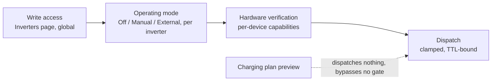

# Battery Control

How the Energy Manager commands a battery: operating modes, write access, dispatch, the hardware
verification gates and the charge limits. Overview: [Energy Manager](../energy-manager.md). The
[charging plan](charging-plan.md) is read-only and does none of this.

## Safety gates

A battery command passes four gates in order. Every gate is a separate switch; none implies another.



!!! note "The charging plan bypasses none of these gates because it never dispatches."

| Gate                      | Where                            | What it does                                                                                                                                                                                               |
| ------------------------- | -------------------------------- | ---------------------------------------------------------------------------------------------------------------------------------------------------------------------------------------------------------- |
| **Write access**          | Inverters page (global)          | Allows the service to write to inverters at all. It also opens the generic `PUT /api/v1/devices/{id}/metrics` routes, so it stays a deliberate, separate switch: choosing a mode never turns it on.        |
| **Mode** per inverter     | Energy Manager page              | **Off**, **Manual** or **External**: who may command this inverter. Selecting Off hands back an active Manager command and verifies the inverter's Internal SoC strategy before disabling Manager control. |
| **Hardware verification** | Background service             | Per-device capabilities; an unverified required capability blocks the dispatch mode it guards. See [Hardware Verification](../reference/hardware-verification.md).                                         |
| **Expert mode**           | Energy Manager page             | A display switch only: it shows a measured verification override, limits and diagnostics. It changes no behaviour.                                                                                       |

## Operating modes

Off is the factory and default Energy Manager state; an inverter without a stored mode is Off. While
every inverter is Off, Energy Manager forecast refresh (spot market and weather) and charging-plan
computation are suspended. Stored configuration and forecast/history data remain intact. Shared
forecast refresh remains active while at least one inverter is Manual or External. General inverter
telemetry, the transport and the consumption history keep running in every mode.

Who may call what, per mode:

| Mode     | Admin GUI (signed-in session, CSRF, no token)                            | REST API with a read/write token (`POST .../energy/command`)                                  |
| -------- | ------------------------------------------------------------------------ | --------------------------------------------------------------------------------------------- |
| Off      | refused, 409 `energy_manager_off`                                        | refused, 409 `energy_manager_off`                                                             |
| Manual   | allowed: charge, keep idle, discharge                                    | refused, 409 `energy_manager_not_external` (an operator must switch the inverter to External) |
| External | refused, 409 `energy_manager_external` ("Controlled by an external app") | allowed                                                                                       |

- In the admin GUI the Charge, Keep idle and Discharge buttons are disabled while the inverter is Off;
  the backend refuses the same calls with 409 `energy_manager_off`. The mode selection stays usable.
- Reading the status (`GET .../energy`) works in every mode, with a session or a token.
- The mode can only be changed in the admin GUI (`PUT /admin/api/energy/devices/{id}/mode`, session and
  CSRF; a token gets 403). Changing the mode to Off, or between Manual and External, first hands the
  inverter back to its previous settings, so an operation started under one mode never outlives it.
- Selecting Off also sets and verifies the inverter's Internal SoC strategy. If that cannot be
  confirmed, the mode stays Manual or External and the UI reports the error. Internal lets the
  inverter choose its own charge power; Off does not request maximum charging power.
- The expert endpoint `POST /api/v1/devices/{id}/battery/dispatch` is independent of the mode.
  External is therefore **not** the only API path to the battery; it is the one for an app that uses
  the business actions (`charge`, `hold`, ...) while the operator keeps the on/off decision.

### Switching on

A newly added inverter has no confirmed operating mode. The admin page shows **Not yet managed** and
the observed inverter SOC strategy; it does not label a new inverter on Constant or External as Off
or Automatic. The public API cannot change the mode. A command while no mode has been selected
answers **409 `energy_manager_off`**.

Selecting Manual or External needs:

1. Write access on (otherwise 409 `energy_write_support_required`; the GUI points to the Inverters
   page).
2. Power limits.
3. The hardware-verification gate.

Selecting Manual or External adds the four dispatch register approvals to the write allowlist if
missing (never removes any), which also opens them to the generic `PUT /api/v1/devices/{id}/metrics`.
Selecting Off hands control back and verifies Internal strategy before changing the mode; it removes
no approval. If the approvals are revoked on the **Inverters** page, the actions report
`write_not_permitted` and commands answer 409 `energy_action_unavailable`. A custom write allowlist
file must contain `power_mng_soc_strategy`, `power_mng_soc_target_set`,
`power_mng_battery_power_extern` and `power_mng_use_grid_power_enable`.

## REST API

Both endpoints need a read/write token and write support, like
[battery dispatch](../api/endpoints.md#battery-dispatch). A command is accepted only while the
inverter is in mode **External**. The status carries `mode` (`off`, `manual`, `external`),
`accepts_commands_from` (`none`, `admin`, `api`) and the derived `armed` flag (`true` unless the mode
is `off`), kept for compatibility. `mode=off` on the public API describes command authorization only;
it does not prove the inverter's physical strategy. The admin page combines the saved mode with a
current strategy reading for that indication.

| Method | Path                                         | Purpose                                                 |
| ------ | -------------------------------------------- | ------------------------------------------------------- |
| GET    | `/api/v1/devices/{device_id}/energy`         | State, readings, target window, per-action availability |
| POST   | `/api/v1/devices/{device_id}/energy/command` | One action: `charge`, `discharge`, `hold`, `auto`       |

```sh
curl -X POST -H "Authorization: Bearer $TOKEN" -H "Content-Type: application/json" \
  -d '{"action":"charge","target_soc_percent":80}' \
  http://127.0.0.1:8000/api/v1/devices/main/energy/command
```

| Action      | `target_soc_percent` | `max_power_w` | Effect                                                                                                                                               |
| ----------- | -------------------- | ------------- | ---------------------------------------------------------------------------------------------------------------------------------------------------- |
| `charge`    | required             | optional      | Charges until the target SoC is reached                                                                                                              |
| `discharge` | required             | optional      | Discharges following the house load until the target SoC; cuts discharge immediately on grid export, bypassing deadband and write interval           |
| `hold`      | omit                 | omit          | Holds the battery at 0 W, grid charging off                                                                                                          |
| `auto`      | omit                 | omit          | Stops the current Manager command and restores the pre-command inverter settings; it does not switch the Manager Off or select the Internal strategy |

- A body that violates the table is rejected with 422 `invalid_request`.
- `max_power_w` defaults to the limit configured for the inverter and is clamped to it
  (`power_limit_clamped: true`).
- The target must lie inside `target_soc_window` (7 % to 95 %: the product range 7 % to 97 %, narrowed
  by the fixed dispatch SoC bounds 5 % and 95 %); otherwise 422 `value_out_of_range`. It is never
  clamped.
- A command lives one hour and is not renewed; the status publishes `until`. A service restart hands
  every running command back to the inverter.
- `auto` replays the captured pre-dispatch registers. If that cannot be confirmed, the answer is 409
  `dispatch_restore_required`; repeating `auto` is the retry.

### Write access toggle

Switching "Write access" on the **Inverters** page is live (no restart): off refuses writes, sets
every device to mode Off and hands the inverters back to automatic operation; on requires choosing a
mode again. If a hand-back fails, the response lists `write_restore_pending` and the automatic restore
retry continues.

### Status readings

`readings` carries `battery_soc_percent`, `grid_power_w` (positive = import), `pv_power_w`,
`house_load_w` and `battery_power_w`, each with `age_seconds` and `stale`. They come from the periodic
read cache (periodic interval, fixed at 30 s), never from a device read, and are `null` with
`stale: true` when unavailable. A missing reading never blocks a command.

`battery_power_w` is **measured**: positive = discharging, negative = charging. `commanded_power_w`
and `commanded_direction` are what the last command **requested**.

An action whose hardware capability is unverified reports `available: false` with reason
`hardware_not_verified`.

## Restore behaviour

- Every command captures the pre-dispatch registers. `auto`, a mode change to Off, switching write
  access off and a service restart hand the inverter back to them.
- A device stuck in `fault_restore_pending` (the restore itself failed) is retried automatically by the
  dispatch cycle. The delay between attempts doubles from 1 s up to 30 s; there is no attempt limit.
  The Energy Manager admin status carries the failed attempts (`restore_attempts`) and the next retry
  time (`next_restore_at`).
- While a device is dispatching or not in mode Off, clearing a required register approval is refused
  (HTTP 409), because the hand-back writes it.

## Charge power limits

Grid charging is bounded by a safety clamp that can only ever **lower** the charge power, never raise
it.

```text
effective charge power = min(requested power, configured static device limit, verified live limit)
```

The static device limit is the verified maximum grid-charge power configured for the device; the
inverter and its BMS keep their own internal protection regardless.

The live-limit term is the **Live Charge Envelope** seam. On this build it is **wired but
unconditionally inert**: the RCT producer always reports "no live limit", so the configured static
limit alone governs. A live limit constrains dispatch only once a real per-device hardware
verification contract exists for its register; no value is derived or invented, and a missing, stale
or unverified limit always falls back to the static bound. Once a verified producer is attached, a
live limit older than a conservative freshness bound is ignored too.

## Capability gates and evidence

The hardware-specific parts of battery dispatch (the external-control strategy code and the sign
conventions for battery power and grid power) are not configured through the environment. They are
**per-device capabilities**, persisted in the dispatch database and set through the admin dispatch
API (`/admin/api/dispatch/...`, not part of the public contract). Current verification status per
feature: [Hardware Verification](../reference/hardware-verification.md).

- **Shipping state is `unverified`.** A fresh database ships every capability as `unverified` with
  assumption defaults the adapter works with (for example `battery_discharge_positive = true`,
  `grid_import_positive = true`). An `unverified` required capability blocks the dispatch mode it
  guards, for that device only.
- **Verification is per device, not per model.** Verifying device A never releases device B, even of
  the identical model and firmware. The only supported transfer is an explicit
  `capabilities:copy-from` call naming the source device and the target model/firmware; it copies only
  capabilities whose evidence matches, and logs each copied row at `WARNING`. A firmware update
  invalidates the capabilities it affects; re-verify after updating.
- **Engineering mode is the only way to dispatch on unverified hardware.** It is a per-device switch
  (`PUT /admin/api/dispatch/devices/{device_id}`), carries a shorter TTL cap than normal operation, and
  still refuses the write-path capability without a strategy code, because the write cannot be formed
  without one.
- **A removed device loses its dispatch state.** Removing a device (or re-addressing it under the same
  id) resets all its capabilities to `unverified`, switches engineering mode off and sets the Energy
  Manager mode to Off. The reset runs only after the new device graph was built.
- **A capability or device-limit change is refused while an operation it affects is active.** Flipping
  a sign convention, re-verifying the write path, or changing the power limits or engineering-mode
  switch of a device with a running dispatch answers `409 dispatch_capability_conflict` and names the
  blocking operation. Stop the operation or let it finish first.

### Evidence fields per capability

Each capability row carries only the evidence that governs it. The dispatch adapter reads every
evidence field from exactly one capability, so `GET .../capabilities` reports it on that row only and
`null` on all others. `null` means "not applicable to this capability", never "unset".

| Capability                      | Evidence field                                                                                                               |
| ------------------------------- | ---------------------------------------------------------------------------------------------------------------------------- |
| `battery_power_sign_convention` | `battery_discharge_positive`                                                                                                 |
| `grid_power_sign_convention`    | `grid_import_positive`                                                                                                       |
| `write_path_convention`         | `soc_strategy_external_code`, `enum_byte_width`, `bool_byte_width`, `write_frame_layout_verified`, `apply_sequence_verified` |
| `export_limit_convention`       | `export_limit_zero_blocks_export`                                                                                            |

`note` is the exception: every capability may carry one.

- A `PUT` that sets an evidence field on a capability that does not govern it is refused with `422`
  instead of storing a value the adapter would ignore.
- **`PUT` replaces the capability record; it is not a partial update.** An omitted evidence field is
  reset to its assumption default, so read the capability first and resend the fields to keep.
- `soc_strategy_external_code` is returned as the raw register value, since the RCT register catalog
  carries no enum label table for it (the meaning is device and firmware specific). It is only
  interpretable together with `note`, so setting `write_path_convention` to `verified` is refused with
  `400` unless the `PUT` supplies a non-empty `note` (hardware model, firmware, what was observed).

## Expert hardware verification override (admin API)

The form uses two session-guarded admin endpoints (CSRF header required, not part of the public API):

| Method   | Path                                                          | Effect                                                                                                                             |
| -------- | ------------------------------------------------------------- | ---------------------------------------------------------------------------------------------------------------------------------- |
| `PUT`    | `/admin/api/energy/devices/{device_id}/hardware-verification` | Verifies `write_path_convention`, `battery_power_sign_convention` and `grid_power_sign_convention` in one transaction, all or none |
| `DELETE` | `/admin/api/energy/devices/{device_id}/hardware-verification` | Revokes the same three; only the status changes, recorded evidence stays                                                           |

The `PUT` body needs `verified_device_model`, `verified_firmware`, a non-empty `note`,
`soc_strategy_external_code` (0-255), `enum_byte_width` and `bool_byte_width` (1-4), and the booleans
`write_frame_layout_verified`, `apply_sequence_verified`, `battery_discharge_positive` and
`grid_import_positive`. Both verification flags must be `true`, otherwise the answer is `400`. A
running operation of the device answers `409 dispatch_capability_conflict`. Both calls return the admin
device status, whose capability rows now also carry the two verification flags.

The `note` documents the write path only. A note already stored on one of the two sign records is
carried over unchanged, because this form has no input field for it. The form covers the write path
and both sign conventions only; `export_limit_convention` cannot be set there and matters only with
`limit_export_during_discharge`, which is off by default.

The application verifies each inverter in the background when the required measurements and safe
conditions are available. It retries an inconclusive check without granting an unverified capability.
The Expert form is a targeted override with measured evidence, not a step in normal setup. The
operator's internal hardware verification plan and filled-in sheets are not part of this site.

## Hold status

`hold` has not been demonstrated on this unit and ships behind the same per-device capability gate as
every other mode; see [Hardware Verification](../reference/hardware-verification.md). A verification
run must show roughly 0 W battery power within one control cycle, a setpoint that stays 0 W for the
full TTL, a clean `auto` return, and no grid charging.

## Admin GUI

The dashboard shows the full live energy-flow graphic (PV, grid, battery, house). The Energy Manager
shows a compact grid, house and battery view beside the controls when space allows. Both use measured,
sign-normalized readings. The dashboard refreshes approximately every 10 s; the Energy Manager page
polls every 3 s; while write support is off the energy device list answers the expected 503 (logged at
DEBUG) and the page polls every 30 s until the next success. An inverter that does not answer is listed
by its configured host.

The Energy Manager exposes its operating mode separately from its command state:

- **Mode (Off / Manual / External):** who may command the inverter, a three-state radio group in the
  card header (`PUT .../mode`). Choosing a mode does not by itself charge or discharge the battery. The
  charge, keep idle and discharge buttons are enabled in Manual only; in External they are disabled and
  the card says "This inverter is controlled by an external app through the API (PAT required)." Off is
  shown as selected only after an explicit Off transition and a fresh readback of Internal strategy; if
  the strategy later changes or cannot be read, the page marks Off as unconfirmed. With Write access
  off, a hint links to the Inverters page.

The device card no longer repeats command state or battery SoC as text; the live-flow graphic shows
the battery reading and current power flows.

The page is layered by in-page progressive disclosure:

| Layer                                           | Content                                                                                                                                                                                                                                                                                                                                         |
| ----------------------------------------------- | ----------------------------------------------------------------------------------------------------------------------------------------------------------------------------------------------------------------------------------------------------------------------------------------------------------------------------------------------- |
| **Operate** (always shown)                      | Device name and connection, the mode control, the current mode sentence, SoC, the actions **Charge battery / Keep battery idle / Discharge battery** with a contextual target-SoC slider and a primary button (for example "Charge battery to 80 %"). Normal cache age is not shown; a transient polling failure shows "Live data unavailable." |
| **Setup** (only when a prerequisite is missing) | A readiness checklist (Inverter connected / Write access / Power limits / Hardware verification). Hardware verification displays background progress or the reason it cannot complete. Power limits are shown in **kW**.                                                                                   |
| **Expert**                                      | The page-wide **Expert mode** switch next to the heading (off on every page load, never stored): measured hardware verification override and **Revoke verification**, kW power limits, engineering mode and the SoC target policy.                                                                   |
| **Diagnostics** (collapsed, inside Expert)      | The gate table (the only place raw `reject_detail` and capability names appear), the capability table, the approved and added write names, per-reading age and staleness, and the poll timestamp.                                                                                                                                               |

Details of the Setup checklist:

- "Write access" is met only when the four required registers (`power_mng_soc_strategy`,
  `power_mng_soc_target_set`, `power_mng_battery_power_extern`, `power_mng_use_grid_power_enable`) are
  approved under **Writable parameters** on the Inverters page; the global write switch alone is not
  enough.
- The first time **Write access** is switched on, these four registers are approved automatically
  (add-only, applied once). Clearing one later is respected: a later off/on toggle does not approve it
  again, the actions answer `write_not_permitted`, and the checklist step shows it missing.
- The hardware verification override is Expert-only. Basic mode shows progress and any blocker but
  never asks for strategy code, byte widths or a verification button. While the Setup block shows
  the power-limit step, that form sits in the Setup block instead.

The action relabels are presentation-only: the REST action names on the wire are unchanged (`charge`,
`discharge`, `hold`, `auto`). If write support is disabled, the Operate poll answers 503 and the page
shows "Manual battery control requires write support to be enabled." instead of the control.

## Upgrade note

The dispatch store adds its Energy Manager tables on first start (schema 3) and the operating mode in
schema 4. On the first start a stored `armed=true` becomes mode `manual` and `armed=false` becomes
`off`. An older build rejects the migrated database; restore a backup to go back. Back up the dispatch
database together with `HMAC_SECRET`, like `data/rct.db`.
