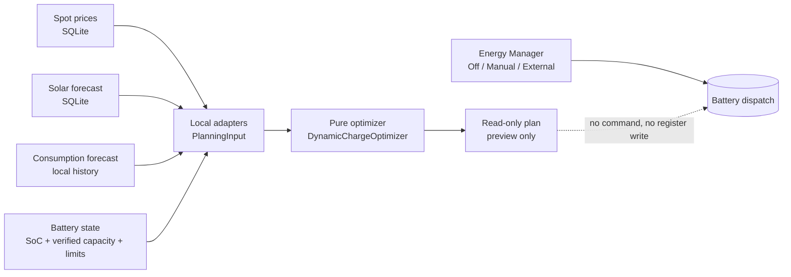
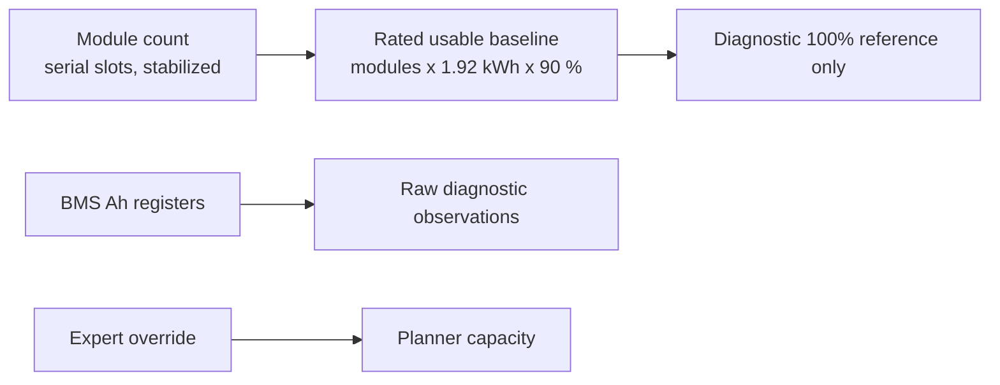

# Charging Plan

The charging plan is a **read-only charging plan preview** (technically a *Dry-Run charging plan*). It
combines local data sources into a proposed grid-charging schedule. It never sends an inverter
command: no executor, no `Dynamic` operating mode, no `EnergyManager.command()`, no dispatch command
and no register write. Overview: [Energy Manager](../energy-manager.md).

## Data flow

The plan is computed on request from local data only. A plan preview triggers **no** Energy-Charts or
Open-Meteo request and never queries the inverter. Control stays with the
[Energy Manager modes](battery-control.md); the plan has no connection to dispatch
(`PlanDispatchHandoff` stays off by default).

## Inputs

| Input                | Source                                                           | Detail                                                                                        |
| -------------------- | ---------------------------------------------------------------- | --------------------------------------------------------------------------------------------- |
| Spot prices          | Persisted day-ahead prices (SQLite)                              | Raw market price; enters the plan basis and change detection only                             |
| Solar forecast       | Persisted Open-Meteo forecast (SQLite)                           | Quarter-hour energy per slot                                                                  |
| Consumption forecast | Local history, adaptive or median                                | [Consumption](consumption.md), [Consumption Forecast](../development/consumption-forecast.md) |
| Battery state        | Read cache SoC, verified or overridden capacity, dispatch limits | See [Usable battery capacity](#usable-battery-capacity)                                       |

## Usable battery capacity

The battery-facts resolver requires a verified current capacity or a persisted per-device Expert
override. The cache-only capacity port currently returns unavailable because the inverter has no
proven signal for a completed, stable BMS capacity calibration. The device list and plan both read
this port; the plan endpoint never queries the inverter.

| Used                                                                                                     | Not used                                                                                |
| -------------------------------------------------------------------------------------------------------- | --------------------------------------------------------------------------------------- |
| Module count from populated serial slots                                                                 | Live battery voltage                                                                    |
| Rated baseline: 1.92 kWh per module at 90 % usable depth of discharge (six modules: 10.368 kWh when new) | A guessed nominal voltage                                                               |
| Ah register readings as raw diagnostics                                                                  | The raw `battery_soh` scale (unverified)                                                |
|                                                                                                          | `battery_stored_energy` and `battery_used_energy` (total energy flow, not a fill level) |

The rated baseline is `modules x 1.92 kWh x 0.9`. It represents 100 % when new, not the
present-day usable capacity. Ah readings do not qualify as a degradation percentage.

Rules for capacity diagnostics:

- The two Ah registers refresh in the background at a bounded daily cadence, with isolated retries
  after failures. Even fresh values are diagnostic only.
- A single tower may have 2 to 6 modules; two towers are accepted only as documented symmetric 4+4,
  5+5 or 6+6. Missing or unsupported data leaves capacity unavailable.
- Module serials are read once per device and then kept. After adding or removing modules, restart
  the service; re-addressing a device in a live reload re-reads it and discards the trusted tower
  topology.

??? info "Why the Ah registers cannot yet determine current capacity"
    The protocol names `battery_ah_capacity` and `power_mng_amp_hours_measured` as capacity in Ah and
    `battery_soh` as State of Health, but gives no usable Wh value, Ah-to-Wh conversion, nominal
    voltage, SoH scale or labels for the `power_mng_battery_type` codes. The Ah values are therefore
    not used as a capacity ratio or standalone Wh. Hardware reads showed 25.0/23.8531 Ah at
    79–87 % SoC and 16.9251/8.65005 Ah near 2.5 % SoC. A changed next calibration date and
    `battery_status2=0` did not establish a stable completed calibration.
    `battery_ah_capacity` x `battery_voltage` is gross,
    voltage-dependent and ignores module count and health. `battery_stored_energy` and
    `battery_used_energy` are total energy flow per the [RCT serial protocol](../reference/protocol.md).
    Per-tower versus device-wide semantics of `battery_placeholder_0_ah_capacity` and other battery
    registers still need characterization, so unsupported tower combinations stay unavailable. See
    [Hardware Verification](../reference/hardware-verification.md).

**Expert override.** Persisted `usable_capacity_wh` values (including seeds from the legacy
`DISPATCH_USABLE_BATTERY_CAPACITY_WH`) stay effective as Expert overrides. Saving other limits
without the capacity field keeps the override; an explicit `null` clears it. Without a reliable
capacity the plan reports `battery_state_unavailable`.

`GET /admin/api/energy/planning-devices` reports `battery_capacity_source` as `verified`,
`expert_override` or `unavailable`.

## How the plan is built

Over a dynamic horizon of 6 to 36 hours at 15-minute resolution the optimizer first simulates the
battery trajectory without grid charging. It then places only the grid energy needed to avoid
undercutting the reserve into the **latest permitted slots**, regardless of earlier cheaper slots,
never exceeding the maximum SoC or the charge-power limit.

- Reserve and maximum SoC are the Energy Manager's effective target window (configured minimum and
  maximum SoC narrowed to the hard product window), so the plan never proposes a target the Energy
  Manager would reject.
- A charge slot raises the SoC by the commanded battery charge power, independent of house load, as
  the dispatch executor does. Round-trip losses are not modelled.
- Scope: grid charging into cheap windows only. No grid export, speculative discharge-to-grid or
  arbitrage cycling.
- Each slot carries a deterministic reason, for example `forecast deficit, charged as late as
  permitted` or `forecast PV covers demand`.
- The stored spot price is the raw day-ahead price. It never moves charging into an earlier slot; no
  absolute household cost is computed, and grid fees, taxes, levies and supplier margin are not
  included.

### Charge policy, reserve and target

Three things stay separate: the **required energy**, the **permitted power** (hard limit: the static
device limit, lowered by a verified, fresh live limit) and the **preferred power** (an optional,
confirmed range inside it). Charging below the preferred range is not assumed to be gentler, and
nothing about battery lifetime is derived from a few measurements.

| Policy             | Behaviour                                                                                                                                 |
| ------------------ | ----------------------------------------------------------------------------------------------------------------------------------------- |
| `gentle` (default) | Keeps the hard limits and the preferred range for the target; secures the reserve; reports an unreachable target and the missing energy   |
| `meet_deadline`    | Always keeps the hard limits; stays in the preferred range when possible; otherwise raises power up to the hard limit to reach the target |

| Concept                                        | Kind                                        | Result fields                                   |
| ---------------------------------------------- | ------------------------------------------- | ----------------------------------------------- |
| Reserve                                        | Hard lower bound along the whole trajectory | `reserve_satisfied`, `reserve_shortfall_wh`     |
| Target (`target_soc_percent` at `target_time`) | Optional goal                               | `target_reachable`, `unserved_target_energy_wh` |

The flags are independent. Both policies may exceed the preferred range to secure the reserve
(reported as a limiting reason). Priority: secure the reserve, then preferred range and policy, then
reach a high SoC as late as possible, then few power changes, and only then price and efficiency.

Placement is **as late as permitted**: for every reserve bottleneck the planner works backwards and
uses the latest permitted slot first (a cheaper slot further back never wins). The target charge sits
directly before the target time, and reserve-only charge it made redundant is dropped. Every
placement is checked by re-simulating the complete trajectory. Partial power is allowed and no
minimum power is invented. Neighbouring charge slots are folded into the later one only if no reserve
deficit appears, nothing is charged earlier, the total energy is preserved and no hard limit is
exceeded; otherwise a small leftover slot stays.

### Assumptions at this development stage

Also listed in the plan's `assumptions`:

- `power_mng_battery_power_extern` is interpreted provisionally as battery-side;
  `power_reference_verified` is `false`.
- The live limit is not available and is not faked; the static device limit applies.
- eta = 0.90 is an explicit planning assumption, not a verified device property.
- The preferred range stays `unverified` and is not a hard planning constraint.

### Physical contract

Dispatch writes the charge setpoint to `power_mng_battery_power_extern` (`app/gateway/rct_dispatch.py`,
`apply_setpoint`). The catalog does not say whether that power is measured at the battery terminals or
on the AC side, so the plan assumes a battery-side setpoint. The plan keeps four energy terms apart:

| Term                         | Meaning                                        |
| ---------------------------- | ---------------------------------------------- |
| `commanded_charge_energy_wh` | Setpoint times duration                        |
| `battery_terminal_energy_wh` | Energy at the battery terminals                |
| `stored_energy_delta_wh`     | SoC change times usable capacity               |
| `grid_charge_energy_wh`      | AC draw for charging only, house load excluded |

Battery-internal losses are not modelled, so terminal and stored energy are equal. A constant
`charge_efficiency` (`configured`, `verified`, or the documented `assumed` default of 90 %, never a
silent 100 %) is applied exactly once: grid energy = terminal energy / efficiency. It never reduces
the simulated SoC a second time. There is currently no setting for a configured efficiency or a
preferred power range, so the API uses the assumed default and no preferred range.

### Live limit

The plan reports `static_charge_limit_w`, `live_charge_limit_w` (null if absent) and
`live_limit_available`. A missing live limit means the static limit applies, never unlimited; the
RCT producer is inert on this build. "Reachable" always means reachable under the currently known
limits; a lower verified live limit wins at the executor and requires a replan.

## Energy Manager Off

Off is the factory/default Energy Manager state. While every inverter is Off, Energy Manager forecast
refresh and charging-plan computation are suspended: no spot-market or weather provider call, no
background plan recompute and no replanning. Stored configuration and forecast/history data remain
intact. An Off inverter gets no plan, an existing plan is dropped when the inverter is switched Off,
and switching to Manual or External resumes the work immediately. Shared forecast refresh remains
active while at least one inverter is Manual or External; planning stays per inverter. The Charging
plan tab is hidden while every inverter is Off and appears without a reload as soon as one is Manual
or External; its inverter select offers only those inverters. If the tab is open when the last
inverter is switched Off, the page returns to the Inverter tab. This does not
change the `enable_automatic_dispatch` setting, which stays independent and off by default.

## Replanning

`app/optimizer/replan.py` (pure `evaluate_replan`, no executor) marks a plan stale when one of these
triggers fires. Triggers and thresholds are returned in the `replan` field of the preview.

| Trigger                                   | Threshold             |
| ----------------------------------------- | --------------------- |
| SoC deviation from the planned trajectory | 5 points              |
| Verified charge limit changed             | 50 W                  |
| Price change                              | 0.01 EUR/kWh          |
| PV or consumption forecast change         | 10 %, at least 250 Wh |
| Planned charge slot delivered less than   | half of its energy    |

## Preview API

| Route                                                    | Use                                                                      |
| -------------------------------------------------------- | ------------------------------------------------------------------------ |
| `GET /admin/api/energy/devices/{device_id}/dynamic-plan` | Admin GUI plan (admin session, not a public token route)                 |
| `GET /api/v1/devices/{device_id}/plan`                   | Runtime plan, same policy, stable enums (see [API](../api/endpoints.md)) |

The preview route accepts `policy`, and the pair `target_soc_percent` / `target_time` (with UTC
offset), as query parameters. The response carries plan status, `created_at`, `valid_until`, forecast
basis and confidence, horizon, slots (action, target SoC, power, reason), the underlying forecast time
ranges and a preview-only note.

### Planner status codes

Missing hard preconditions return a status with HTTP 200, never a 500 or raw hardware detail.

| Status                       | Meaning                                                          |
| ---------------------------- | ---------------------------------------------------------------- |
| `energy_manager_off`         | Inverter is Off; nothing was read or computed                    |
| `battery_state_unavailable`  | No verified battery state or capacity                            |
| `spot_disabled`              | Spot market switched off or incomplete; waiting does not help    |
| `spot_prices_unavailable`    | Spot market configured, no usable prices yet                     |
| `solar_not_configured`       | Solar forecast switched off or incomplete; waiting does not help |
| `solar_forecast_unavailable` | Solar forecast configured, no usable data yet                    |

### Forecast basis

Consumption history is a preview-quality input, not an availability gate. A fresh device shows a plan
as soon as battery, price and solar preconditions are met.

| Field                           | Values                                                                                                         |
| ------------------------------- | -------------------------------------------------------------------------------------------------------------- |
| `forecast_basis`                | `bootstrap_baseline` (configured `baseline_household_load_w`), `history_fallback` (median), `adaptive_history` |
| `consumption_history_available` | whether history exists                                                                                         |
| `forecast_confidence`           | stable enum; low for bootstrap and median fallback                                                             |

Consumption no longer blocks a runtime plan; the usable battery capacity still does, until an Expert
override or a verified automatic source exists. The free-form description stays in the plan
assumptions and is not a contract field. A baseline-based plan sends no battery command.

### BatteryState block

The `battery` block is the `BatteryState` snapshot the plan was computed from.

| Field                                         | Meaning                                              |
| --------------------------------------------- | ---------------------------------------------------- |
| `soc_percent`                                 | State of charge                                      |
| `usable_capacity_wh`                          | Verified or overridden usable capacity               |
| `remaining_energy_wh`                         | Usable capacity x SoC / 100, never the nominal total |
| `max_charge_power_w`, `max_discharge_power_w` | Configured limits                                    |
| `measured_at`                                 | Time of the snapshot                                 |

The block is `null` when no verified battery state exists (`battery_state_unavailable`); remaining
capacity is never estimated and no extra inverter or provider query is made.

## Charging plan tab

Basic mode shows the capacity source and the read-only preview ("Dynamic charging plan (Dry-Run
preview)"). The result area uses the full card width:

- Header: title with the forecast confidence (or "Baseline forecast" when the plan uses the configured baseline, when available) on one line, preview note, Inverter select, Expert switch.
- Four equal KPI tiles (four columns on desktop, 2 x 2 on tablets, stacked on phones): Battery
  remaining (usable energy now, for example `33 % SoC - 10.37 kWh usable`, or a dash without a battery
  snapshot), Target SoC, Charge power, total plan grid energy.
- The schedule as a time-series chart (the temporal overview): grid charge power (kW, idle slots at
  0) and target SoC (%, second axis) on a real time axis, so slots of uneven length keep their
  length. The tooltip shows only what applies: an idle slot reads "No grid charging" plus the
  plain-language reason; a charge slot reads "Grid charging" with power, target SoC and the reason.
  The canvas has a text summary and is described by the "Charging schedule" table below it.
- **Charging schedule**, directly under the chart: only the planned active grid-charging windows,
  with Time, Power, Target SoC and Purpose. Directly adjacent charge slots merge only when power,
  target SoC and reason are identical; a change or an idle slot in between starts a new row. Without
  charge slots it reads "No grid charging planned." Narrow screens stack each row into labelled
  key-value pairs.
- **Show all intervals** (a native disclosure): the complete technical slot history with Time,
  Action, Power, Target SoC and Reason for every interval; directly adjacent intervals merge only
  when action, power, target SoC and reason are identical. The action reads "Grid charging" or "No
  grid charging", the reason is the plain-language label (for example "Battery can cover forecast
  demand"). Idle intervals are only hidden from the default view, never removed from the plan.
- Purpose is the short, user-facing form of the planner reason: "Protect battery reserve", "Reach
  target SoC", "Use negative price", "Solar covers demand", "Battery covers demand". An unknown
  reason is shown as the original text. The planner reasons themselves are unchanged.
- Below it, the consumption bar chart ([Consumption](consumption.md#daily-consumption-api)).
- The forecast windows (consumption, solar, price) and the note that prices are raw day-ahead prices
  only. The "Next grid charge" hero metrics sit in one row (stacked on narrow screens).

### Loading behaviour

| Situation                                                                                   | Behaviour                                                                                                                                                                                                                                                         |
| ------------------------------------------------------------------------------------------- | ----------------------------------------------------------------------------------------------------------------------------------------------------------------------------------------------------------------------------------------------------------------- |
| Normal                                                                                      | Loads when an inverter is selected, then every 5 minutes and when the browser tab becomes visible; no Refresh button                                                                                                                                              |
| Input only pending (spot prices, solar forecast, consumption model)                         | Rotating "Please wait ..." spinner; the plan is re-requested every 10 s, at most 30 times per status, then the status text with the readiness checklist stays. A new load, a device change or a hidden tab stops the polling; a changed status restarts the count |
| Battery state missing or unverifiable                                                       | Not pending: explanation shows at once ("Check that the inverter is connected and reports its battery state and capacity"); plan re-requested quietly                                                                                                             |
| Cannot be fixed by waiting (spot market disabled, solar forecast not configured) and errors | Explanatory text with the readiness checklist (battery capacity, spot prices, solar forecast, consumption model, each with a text state such as "disabled in settings")                                                                                           |

Expert mode also shows the checklist, including "Battery data could not be verified automatically.",
below the spinner.

### Expert mode

Expert mode adds **Advanced diagnostics** (Battery capacity: status, source, override; Power limits:
charge, discharge; Battery calibration history; Forecast inputs: consumption, solar, prices) and the
**Battery data override** form for verified charge and discharge power (kW) and usable capacity (kWh).
It saves through `PUT /admin/api/energy/devices/{device_id}/planning-limits` into the same per-device
store; an empty capacity clears the override.

Preview and override work with write access off and do not activate battery control. The Inverter
Setup limits form keeps a stored capacity when its capacity field is empty; that field is visible
only in Expert mode. Capacity is a planner prerequisite, never a prerequisite for manual control.

## Battery diagnostics

### Battery register comparison

`GET /admin/api/energy/devices/{device_id}/battery-characterization` returns cached raw battery
registers with their catalog units, age and freshness, plus the stabilized module count for each
tower. It never reads the inverter on its own. To request a bounded device read, call
`POST /admin/api/energy/devices/{device_id}/battery-characterization/refresh` with a `names` array of
one to four listed numeric or enum registers. A read-only admin token may use both routes; a cookie
session needs its CSRF header for `POST`. A second tower is not probed until its module inventory
confirms that it exists. The result reports raw observations only and never derives usable Wh from
them. The Ah readings remain unsuitable for a current-capacity claim until a completion signal and
stable post-calibration values are verified against the RCT app.

### Battery calibration history

The service currently writes no new calibration points: a changed Ah reading does not prove that a
calibration completed. Existing `bms_ah_ratio_v1` rows remain in SQLite but are excluded from the
effective history, API chart and capacity percentage. The chart becomes meaningful after a proven
calibration contract is implemented and new qualified points exist.

The curve starts at a commissioning date. A date entered by an operator always works and wins. After
a battery replacement a derived date is not used for the new series; enter the replacement date. A
background service can derive the date once per inverter serial from the earliest energy in the
inverter's year and month logs (`logger_year_eac_log_ts`, `logger_month_eac_log_ts`); this derivation
is **unverified on hardware** and switched off by default
(`battery_commissioning_derivation_enabled`, an internal switch, not an environment variable); see
[Hardware Verification](../reference/hardware-verification.md).

| Method   | Path                                                                | Effect                                                                                                                                                                                                                                                                                                       |
| -------- | ------------------------------------------------------------------- | ------------------------------------------------------------------------------------------------------------------------------------------------------------------------------------------------------------------------------------------------------------------------------------------------------------ |
| `GET`    | `/admin/api/energy/devices/{device_id}/battery-calibration-history` | History, commissioning date and baseline for the inverter's current battery series (`limit` 1 to 5000, default 1200). Local store only, no device I/O. `baseline_unavailable_reason` is `inverter_serial_unknown`, `no_commissioning_date`, `no_measurement` or `battery_replaced` when there is no baseline |
| `PUT`    | `/admin/api/energy/devices/{device_id}/battery-commissioning`       | Sets the manual commissioning date (body `{"commissioned_on": "YYYY-MM-DD"}`, between 2010-01-01 and today; 409 while the inverter serial is unknown, 422 outside the range)                                                                                                                                 |
| `DELETE` | `/admin/api/energy/devices/{device_id}/battery-commissioning`       | Removes the manual date; a derived one (only with the derivation enabled) applies again                                                                                                                                                                                                                      |

All three need an admin session (read-only for `GET`; `PUT` and `DELETE` need the CSRF header).

Background Ah reads and commissioning-date derivation (when enabled) run while write support is off.
No Ah read currently records a calibration point.

The dashboard offers the data as selectable widgets (off by default, added through **Edit Widgets**):
the tiles *Usable capacity*, *Capacity vs datasheet*, *Battery cycles*, *Last calibration* and
*Commissioned*, and the *Battery degradation* chart (remaining capacity in % over time, one curve per
inverter serial, starting at the commissioning date when it is known). Without data they show "Serial
unknown", "No data yet" or "No inverter available". A commissioning date derived from the logs is
labelled "derived, unverified".
