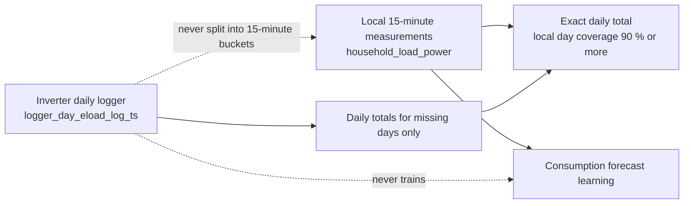

# Consumption History and Daily Backfill

How the service records household consumption, how the inverter's own daily log fills gaps, and
which data may train the consumption forecast. Part of the [Energy Manager](../energy-manager.md);
consumption data feeds the [charging plan preview](charging-plan.md).

| Question                                        | Answer                                                                                                             |
| ----------------------------------------------- | ------------------------------------------------------------------------------------------------------------------ |
| Where does the data come from?                  | The `household_load_power` value the service already reads, plus the inverter's daily load logger for missed days. |
| Extra inverter reads for the 15-minute history? | None. A passive observer reuses the periodic read path.                                                            |
| How long is it kept?                            | 15-minute buckets: rolling 60 days. Daily totals: the last 60 completed local days.                                |
| Which source trains the forecast?               | Local 15-minute measurements only.                                                                                 |

## Consumption backfill

The backfill closes gaps in the daily consumption record. It never invents quarter-hour data.

!!! info "The backfill never fabricates quarter-hour measurements and never trains the consumption forecast."

| Source                       | Daily total | Forecast learning | 15-min profile |
| ---------------------------- | ----------- | ----------------- | -------------- |
| Local 15-minute measurements | yes         | yes               | yes            |
| Inverter daily history       | yes         | no                | no             |

Contract:

- The backfill is **always on** and **read-only**: it uses the normal device queue and needs no
  write permission.
- It covers **completed local calendar days only**, never the running day, for the last 60 days.
- **Local complete measurement wins.** A day counts as locally measured at 90 % or more local-second
  coverage; otherwise a stored inverter total is used. The sum of both is never taken.
- Only days that are neither measured locally nor stored yet are fetched. The values the inverter
  provides go to `consumption_daily_history`; everything else stays `unavailable`.
- The inverter day history is **never decomposed into artificial quarter-hour buckets**
  (`profile_available` is false for such days).
- Days are local calendar dates of the site time zone; a 23 h or 25 h DST day is still one date.

### When it runs

A background service starts shortly after the service start, after an outage and about once a day.
It repairs multi-day outages and bootstraps the daily history of a new installation.

### Device query behaviour

The history query is not a register write, but it is a request frame with a timestamp. A firmware
that ignores it makes the request time out. The transport keeps the connection for other objects
after the first miss, re-reads that object on a new connection and reconnects on a second miss in a
row; the service then backs off for six hours.

### Logger semantics (hardware observations)

`logger_day_eload_log_ts` is verified on hardware; see
[Hardware Verification](../reference/hardware-verification.md).

| Property                 | Observed behaviour                                                                                                        |
| ------------------------ | ------------------------------------------------------------------------------------------------------------------------- |
| Unit and day             | Wh per **local calendar day**                                                                                             |
| Timestamps               | Local wall-clock fields, labelled UTC                                                                                     |
| `before=` query boundary | On the tested inverter, the 2026-10-18 A/B returned the boundary point only when local wall-clock fields were encoded as UTC |
| Duplicate points         | The logger may repeat one day's 23:59:59 point 8 to 16 times with values differing by under 1 Wh; the largest value wins  |

Jitter within 5 Wh or 0.5 % is logged at debug level; only a larger spread logs a warning with the
minimum and maximum.

!!! note "`before=` A/B on the tested inverter"
    - A: true UTC instant `1792101600` as `before=`: the 2026-10-15 day point was **missing**.
    - B: local wall-clock `1792108800` encoded as UTC: the point was **present** at 18018.6797 Wh.
    - The result matched the operator's export and repeated the earlier comparison. It confirms this
      encoding on the tested inverter only; other device/firmware combinations still need verification.

`tools/probe_consumption_history.py` repeats this check read-only on a real inverter.

## 15-minute measurement history

The service builds a local history of the `household_load_power` metric. It does not depend on
QuestDB, InfluxDB or metrics export. A passive observer buffers each value; a background task
integrates the samples into fixed 15-minute energy buckets off the receiver path and writes them to
the `consumption_history_intervals` SQLite table (one row per device and quarter hour). A SQLite
error there never disturbs the inverter connection or the read cache.

| Rule                    | Value                                                                                                      |
| ----------------------- | ---------------------------------------------------------------------------------------------------------- |
| Integration             | Time-weighted: `Wh = W x hours`, split across any 15-minute boundary                                       |
| Measurement gap         | A negative, non-finite or missing reading adds no energy and no sample count; integration never bridges it |
| Maximum integration gap | 5 minutes; a longer dropout leaves the period uncovered                                                    |
| Per-bucket quality      | `sample_count` and `coverage_seconds` (at most 900 s)                                                      |
| Missing samples         | Never read as `0 W`                                                                                        |
| Retention               | Rolling **60 days** (code default); pruning touches only the consumption table                             |

### Counter capture

`app/optimizer/meter.py` differences the cumulative load counter `energy_e_load_total` (Wh, float32)
into 15-minute buckets next to the integrated `household_load_power`. A `HistoryBucket` has a quality:

| Quality   | Meaning                                           |
| --------- | ------------------------------------------------- |
| COMPLETE  | at least 810 s measured                           |
| PARTIAL   | at least 600 s measured                           |
| ESTIMATED | gap of 300 s to 24 h spread as a flagged estimate |
| MISSING   | no usable data                                    |

A gap of at most 300 s is measured. Counter resets, deltas above 50 kW, stalled counters and gaps over
24 h are rejected and counted; the day counter is the fallback. Nothing beyond "non-decreasing
between resets" is assumed about the counter; open points are listed in
[Hardware Verification](../reference/hardware-verification.md).

## Daily consumption API

Both routes read the local store only and never access the device. Full parameters:
[API endpoints](../api/endpoints.md#daily-consumption).

| Route                                                              | Purpose                    |
| ------------------------------------------------------------------ | -------------------------- |
| `GET /api/v1/devices/{device_id}/consumption/day?date=YYYY-MM-DD`  | One local day              |
| `GET /api/v1/devices/{device_id}/consumption/days?from=...&to=...` | A range of at most 60 days |

`source` is one of:

| `source`           | Meaning                                                    |
| ------------------ | ---------------------------------------------------------- |
| `local_measured`   | 15-minute profile available                                |
| `inverter_history` | Day total only, `profile_available` false                  |
| `unavailable`      | `energy_wh` is null; the running day is always unavailable |

The Charging plan tab shows the same data as a bar chart of the last 60 completed days (green:
locally measured, blue: inverter day total, gap: unknown) with the daily average over known days,
fed by `GET /admin/api/energy/devices/{device_id}/consumption-history` (local store only). While no
day has data, the whole section stays hidden.

## Forecast learning versus daily reconciliation

Two separate mechanisms use consumption data:

|                      | Forecast learning                                            | Daily reconciliation                            |
| -------------------- | ------------------------------------------------------------ | ----------------------------------------------- |
| Purpose              | Predict the next day for the charging plan                   | Keep an exact daily total, also for missed days |
| Input                | Clean, closed, sufficiently measured local 15-minute buckets | Local totals, inverter daily history for gaps   |
| Inverter day history | Never used                                                   | Used for missing days only                      |

The forecast is deterministic, without machine learning. It separates the everyday profile (a capped
mean per local weekday and quarter hour) from the current consumption phase:

- A contiguous stretch of clearly reduced consumption is labelled *suspected low activity*
  (never "absence"). The profile is then frozen and the forecast follows the low level.
- Several consecutive well-measured observations resembling the profile return the forecast to it;
  a single spike or heavy appliance does not.
- Estimated buckets and outages are neither vacation nor zero consumption.
- Lasting changes are learned via a level factor (about three days) or, after four weeks, by
  promoting the phase to the new normal.
- Fewer than 14 usable days: median forecast (same weekday, then time of day, then whole history) at
  low confidence. No usable history: the configured `baseline_household_load_w` as an explicit
  low-confidence bootstrap assumption, never presented as measured.
- The next local day (92 to 100 slots) is stored once per day after 22:00 local time with its basis
  and later compared with measured actuals.

Algorithm, thresholds and measured behaviour:
[Consumption Forecast](../development/consumption-forecast.md).
